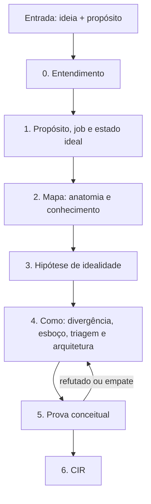
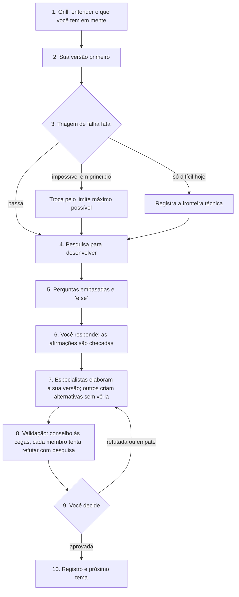

# Fluxograma aperfeiçoado — Etapa 1 (CIR)

<aside>
🔀

**O que é:** a versão corrigida do fluxograma que você descreveu, alinhada ao [Método IDEAL — passo a passo](../M%C3%A9todo%20IDEAL%20%E2%80%94%20passo%20a%20passo%200a6e02fec42e47e09d4a10981b12849b.md) e explicada com o mesmo exemplo, o Motor de Insights. É a base do novo plano da skill, que ainda não foi reescrito.

</aside>

## 1. Resumo das correções

Fica o núcleo do seu fluxograma: entender antes de trabalhar, perguntas embasadas, especialistas que desenvolvem, conselho que julga e pesquisa que tenta refutar. Mudam estes pontos:

| No seu fluxograma | Na versão aperfeiçoada | Por quê |
| --- | --- | --- |
| O propósito chega pronto | O propósito também passa pelo ciclo e vira um só, no nível do "para quê" (passo 1) | "Eliminar vieses" é um meio. Um propósito no nível do mecanismo deixa de fora o que faz o resultado acontecer |
| Da ideia direto para a hipótese | Antes da hipótese, um **mapa**: como o job falha hoje e o que a ciência já sabe (passo 2) | Sem o mapa, as perguntas não têm base e as ideias repetem o que já existe. É do mapa que sai a composição do conselho |
| A hipótese é uma descrição | A hipótese vira **métricas de idealidade**, um Resultado Final Ideal e o teste do impossível (passo 3) | Sem métrica, "ideal" vira opinião, e não há o que provar ou refutar |
| Primeiro as perguntas, depois a pesquisa | Primeiro a pesquisa, depois as perguntas | Pergunta embasada precisa de fonte |
| Valida-se a sua hipótese | A sua compete com alternativas criadas por agentes que não a viram | Sem alternativas, dá para dizer "não refutada", nunca "a melhor" ([Platt](https://doi.org/10.1126/science.146.3642.347)) |
| O conselho sabe qual hipótese é sua | O conselho julga às cegas (H1, H2, H3…) | Modelos tendem a concordar com o usuário ([Sharma et al.](https://arxiv.org/abs/2310.13548)) |
| Conselho e pesquisa de refutação em sequência | Uma etapa só: cada membro do conselho pesquisa para derrubar pela sua ótica | O julgamento já nasce com evidência, e uma rodada inteira é economizada |
| Uma validação por tema | Duas: uma triagem rápida antes de elaborar e a validação completa depois | Ver seção 2 |
| Validação por opinião e pesquisa | No fim, prova com 10 a 20 casos reais e comparação com a melhor abordagem atual (passo 8) | Opinião, mesmo de especialista, não substitui caso com desfecho conhecido |
| Sem registro | Toda decisão deixa rastro: opções, evidência, dissenso e o que a reverteria | É o que permite mostrar por que a ideia vence as alternativas |

## 2. Validar antes ou elaborar antes?

**Resposta curta:** nenhum dos dois por inteiro. Valide antes só o que pode matar a ideia, elabore e depois valide tudo.

- **Validar tudo antes de elaborar** parece mais rápido, mas sai mais caro. Hipótese vaga gera veredito vago, porque só dá para refutar o que é específico. Avaliar cedo também favorece o óbvio: na hora de escolher, as pessoas preferem ideias viáveis às originais ([Rietzschel, Nijstad e Stroebe](https://doi.org/10.1348/000712609x414204)) e, sob incerteza, rejeitam ideias criativas sem perceber ([Mueller, Melwani e Goncalo](https://doi.org/10.1177/0956797611421018)). E, depois de elaborar, seria preciso validar de novo.
- **Elaborar tudo antes de validar** desperdiça esforço quando há uma falha fatal. No exemplo, elaborar "eliminar qualquer viés" seria trabalhar num alvo impossível (tema 3 da seção 4).
- **A saída é uma triagem de falha fatal**, de poucos minutos, antes de elaborar. Ela só checa o que a Etapa 1 preserva: lógica, matemática e ciência; natureza humana; propósito e valores (seção 3 da [Etapa 1 — Concepção Ideal da Solução: método IDEAL (v2)](../../Etapa%201%20%E2%80%94%20Concep%C3%A7%C3%A3o%20Ideal%20da%20Solu%C3%A7%C3%A3o%20m%C3%A9todo%20IDEAL%20%20629394b6e12b49c792805775c07e27d3.md)). Nada é descartado. O que é impossível em princípio troca de alvo pelo limite máximo possível; o que é só difícil ou caro hoje vira fronteira técnica e segue.
- **A validação completa** (conselho, refutação e, no fim, casos reais) roda uma vez por tema, sobre a versão elaborada e contra alternativas. É a parte cara, então só roda quando há algo específico para julgar.

## 3. O fluxograma aperfeiçoado

### 3.1 Os temas

Cada tema roda o ciclo da seção 3.2. O conselho também pode ser chamado a qualquer momento.

| Tema | Passos do IDEAL | O que sai | Validação |
| --- | --- | --- | --- |
| 0. Entendimento | Pré-requisito | Ficha do projeto, confirmada por você | Você confirma |
| 1. Propósito | 1 | Um propósito, o job, os papéis e o estado ideal; o propósito fica congelado | Conselho |
| 2. Mapa | 2 | Etapas do job, falhas e causas, contradições, o que se sabe e o que não se pode saber; a lista de especialistas | O crítico confere as fontes |
| 3. Hipótese de idealidade | 3 | De 5 a 12 métricas com linha de base e limite, o Resultado Final Ideal e os alvos ajustados pelo teste do impossível | Conselho |
| 4. Como | 4 a 7 | Banco de ideias com pelo menos 3 famílias, esboço, triagem e 2 ou 3 arquiteturas funcionais | Conselho nas decisões de triagem |
| 5. Prova | 8 | O conceito de referência, com nível de confiança | Conselho completo e casos reais |
| 6. CIR | 9 | CIR, pacote da Etapa 2 e estacionamento da Etapa 3 | Critério de pronto |

### 3.2 O ciclo de cada tema

1. **Grill.** Entende o que você pensa sobre o tema antes de qualquer trabalho, com perguntas que fazem refletir, embasadas e sem resposta recomendada (seção 5).
2. **Sua versão primeiro.** Você escreve a sua hipótese antes de ver qualquer ideia da IA. Quem vê um exemplo antes tende a copiá-lo ([Jansson e Smith](https://doi.org/10.1016/0142-694X%2891%2990003-F)). Se você não tiver uma, a IA propõe várias, nunca uma só.
3. **Triagem de falha fatal.** Só as restrições preservadas e o teste do impossível. Minutos, não horas.
4. **Pesquisa para desenvolver.** De 3 a 5 pesquisadores em paralelo, um por especialidade, buscando o que fortalece, amplia ou corrige a sua versão (seção 7).
5. **Perguntas embasadas.** O questionador transforma a pesquisa em 3 a 5 perguntas com fonte e explicação, incluindo "e se" e contraexemplos.
6. **Você responde.** Cada afirmação sua é checada contra as fontes. Se uma contradiz a evidência, a IA mostra a evidência e pergunta de novo, sem entregar a resposta.
7. **Elaboração e alternativas.** Um grupo de especialistas desenvolve a melhor versão da sua hipótese. Outro, que não viu a sua, cria alternativas com princípios diferentes, para que elas não fiquem presas à sua.
8. **Validação.** O conselho recebe H1, H2, H3… sem saber qual é a sua, com o critério de refutação escrito antes. Cada membro pesquisa e julga sozinho; só há debate se houver divergência relevante (seção 6).
9. **Você decide.** Escolhe, combina ou pede outra rodada. Se tudo for refutado, volta ao passo 7.
10. **Registro.** Decisão, alternativas, evidência, dissenso, nível de confiança e o que reverteria a decisão. Depois de congelado, o propósito só muda por decisão explícita sua.

**A dose muda por tema.** No tema 0 há só grill e ficha. No tema 2, a pesquisa pesa mais que o conselho. No tema 4, o passo 7 é a divergência completa do método. A validação mais forte fica no tema 5.

**Se você já tiver a hipótese,** o grill é curto e o ciclo começa na triagem. As alternativas continuam, porque sem elas não há com o que comparar.

**Conselho sob demanda:** quando estiver indeciso, você pede no chat e a condutora escolhe o template pelo tipo de dúvida.

### 3.3 Quem faz o quê

| Papel | O que faz | Regra principal |
| --- | --- | --- |
| Condutora | Conduz os temas e o ciclo, chama os outros papéis e mantém o dossiê | Não opina sobre a ideia |
| Grill | Abre cada tema entendendo o que você tem em mente | Sem resposta recomendada |
| Questionador | Faz perguntas embasadas depois da pesquisa e sugere ideias | Toda pergunta traz fonte e explicação |
| Pesquisadores | Buscam na web e em artigos, em paralelo, por especialidade | Fonte aberta e conferida; sem fonte, vira hipótese |
| Especialistas | Desenvolvem a sua versão e criam alternativas | Montados a partir do mapa (tema 2) |
| Conselho | Julga às cegas, sob óticas diferentes | Independência antes do debate |
| Crítico | Confere método, lógica e fontes de todos | Fixo em todo conselho |
| Você | Gera primeiro, responde e decide | A decisão é sempre sua |

## 4. O mesmo exemplo, na versão aperfeiçoada

Os desfechos abaixo são um exemplo possível, para mostrar o fluxo funcionando. As decisões reais são suas.

### Tema 0 — Entendimento

Você chega com a ideia, "um motor que analisa dados de forma perfeita", e o propósito: eliminar qualquer viés, manipulação e má interpretação e, mesmo com um volume gigante e desorganizado de dados, entregar o insight certo que só uma equipe gigante de especialistas daria.

O grill ainda não discute a ideia. Ele monta a ficha com perguntas como:

- "Quando você diz 'insight certo', certo em relação a quê: ao que aconteceu, ao que vai acontecer ou à melhor decisão possível com a informação disponível?"
- "Quem usa o insight, e para decidir o quê? Lembre um caso real em que um insight errado custou caro."
- "O que você já tem escrito?" Aqui entram o [Motor de Insights: ideia central e documento de produto (v1, sem nicho)](https://app.notion.com/p/Motor-de-Insights-ideia-central-e-documento-de-produto-v1-sem-nicho-436c97b6ae4643a78b4e92a024e27bfb?pvs=21) e o [Anexo A: análise crítica da ideia central e modos de falha](https://app.notion.com/p/Anexo-A-an-lise-cr-tica-da-ideia-central-e-modos-de-falha-3befc44c58ea4ad98810f81b50f638e2?pvs=21), com 18 pontos fracos e 20 modos de falha. O trabalho parte deles, não do zero.

A ficha separa o que se sabe, o que é incerto e o que ninguém sabe ainda, e lista as especialidades envolvidas. Você confirma, e o tema fecha.

### Tema 1 — Propósito

- **Grill:** "Para que eliminar o viés? E para que o insight certo?" Você responde: "para a pessoa decidir certo, a tempo, sem precisar de uma equipe gigante".
- **Sua versão:** você escreve de 3 a 5 versões do propósito.
- **Triagem:** o propósito, como está, tem três falhas. São vários propósitos num só (viés, manipulação, má interpretação, escala), e o método pede um. Está no nível do mecanismo: eliminar viés é um meio. E "eliminar qualquer" e "garante" esbarram em limites científicos, o que fica registrado para o tema 3.
- **Pergunta embasada:** "I. J. Good provou que, para um decisor racional, informação nova e gratuita nunca piora a decisão esperada ([Good, 1967](https://doi.org/10.1093/bjps/17.4.319)). Ou seja, a informação vale pela decisão que muda. Se o valor do insight está na decisão, por que o propósito termina no insight?"
- **"E se":** "E se o insight for perfeito e a pessoa confiar demais nele? Explicações aumentam a aceitação da IA mesmo quando ela erra ([Bansal et al.](https://doi.org/10.1145/3411764.3445717)). O propósito foi cumprido?"
- **Alternativas e validação:** os especialistas desenvolvem a sua versão; outros propõem versões como "quem decide chega, a tempo, à decisão que tomaria com a melhor equipe de especialistas e toda a informação relevante, e sabe quanto pode confiar nela". O conselho julga às cegas.
- **Decisão (exemplo):** o propósito sobe de "eliminar vieses" para "decidir bem", a mesma pergunta que a v2 já levantava ("o job é receber insights ou decidir bem?"). Viés, manipulação e má interpretação não somem: viram falhas no mapa do tema 2 e métricas no tema 3. O propósito é congelado.

### Tema 2 — Mapa (novo)

Os pesquisadores dividem o job em etapas e procuram, em paralelo, onde e por que cada uma falha. Boa parte já está no Anexo A; o mapa o reaproveita e acrescenta a ciência por trás de cada falha.

| Etapa do job | Falha | O que a ciência diz | Caso real |
| --- | --- | --- | --- |
| Localizar | Volume enviesado tratado como população | Com uma correlação mínima entre estar nos dados e a resposta, 2,3 milhões de respostas valeram tanto quanto cerca de 400 aleatórias ([Meng, 2018](https://doi.org/10.1214/18-AOAS1161SF)) | Uma pesquisa com 250 mil respostas por semana superestimou a vacinação nos EUA em 17 pontos ([Bradley et al., 2021](https://doi.org/10.1038/s41586-021-04198-4)) |
| Confirmar | Eco parece corroboração | Fontes que repetem a mesma origem não são independentes | Dez portais repetindo uma nota (Anexo A, modo de falha 3) |
| Interpretar | Padrão falso | Quanto mais relações se testam, maior a fração de achados falsos ([Ioannidis, 2005](https://doi.org/10.1371/journal.pmed.0020124)) | Quantopian (Anexo A, 2.8) |
| Interpretar | Correlação lida como causa | Algumas causas não são identificáveis só com dados (Hernán e Robins, Anexo A, 2.10) | Viés de notoriedade na farmacovigilância |
| Confirmar | Manipulação que imita o legítimo | Para texto gerado por IA, o melhor detector possível é limitado pela semelhança entre texto humano e gerado ([Sadasivan et al.](https://arxiv.org/abs/2303.11156)) | Tweet falso da AP em 2013 |
| Monitorar | Regra que para de valer | Relações estatísticas mudam com o tempo | Zillow (Anexo A, 2.9) |
| Executar | Confiança excessiva | Viés de automação, em leigos e em especialistas (Parasuraman e Manzey, na v2) | Bansal et al. (Anexo A, 2.13) |

O mapa também lista as contradições, como "mais contexto melhora a leitura, mas multiplica as relações testadas" e "ver antes piora ver certo" (Anexo A, 2.7), e o que não se pode saber: causas não identificáveis e manipulação indistinguível do legítimo.

**Do mapa sai o conselho:** cada família de falha pede uma especialidade. Aqui: estatística, inferência causal, ciência da computação e segurança, desinformação e redes, análise de inteligência, ciência cognitiva da decisão e teoria da informação.

### Tema 3 — Hipótese de idealidade (a sua "hipótese")

- **Grill:** "O que faz um motor de análise ser perfeito?" Você responde: "eliminar os vieses, a manipulação e a má interpretação".
- **Sua versão (H1):** "o motor perfeito é o que elimina todo viés, toda manipulação e toda má interpretação".
- **Triagem (teste do impossível):** as três exigências são impossíveis em princípio. Aprender com dados exige suposições: sem elas, nenhum método é melhor que outro na média dos problemas possíveis ([Wolpert, 1996](https://doi.org/10.1162/neco.1996.8.7.1341)). Três definições intuitivas de "sem viés" não podem valer ao mesmo tempo, salvo casos muito restritos ([Kleinberg, Mullainathan e Raghavan](https://arxiv.org/abs/1609.05807)). A manipulação que imita perfeitamente o legítimo não se distingue pelo conteúdo, e há causas que os dados não identificam (tema 2).
- **Nada é descartado.** Os alvos trocam pelo limite máximo possível que a v2 já define: "toda manipulação detectável identificada e rotulada; a indetectável tratada como incerteza"; "nenhuma conclusão sem lastro, incerteza declarada e a mesma conclusão quando se trocam os lados"; "detectar quando a conclusão depende de algo não observado, dizer que evidência resolveria e ir buscá-la".

**Perguntas embasadas, no estilo que você pediu:**

1. "James e Stein provaram que, ao estimar três ou mais médias ao mesmo tempo, um estimador com viés erra menos, no total, do que as médias sem viés ([Efron e Morris, 1977](https://doi.org/10.1038/scientificamerican0577-119)). Se o objetivo é o insight certo, o motor perfeito elimina o viés ou minimiza o erro total? Em que caso os dois discordam?"
2. "Kleinberg e coautores provaram que não dá para ter as três definições de 'sem viés' ao mesmo tempo. Qual o seu motor escolhe, e quem perde com a escolha?"
3. "Meng mostrou que volume não compensa seleção enviesada. Se o 'volume gigante' faz parte da promessa, o ideal é ter mais dados ou dados melhores? E se o volume piorar a resposta?"
4. "E se o motor for perfeitamente calibrado, mas a pessoa confiar demais nele? Ele continua perfeito?"

**Elaboração e alternativas:** os especialistas desenvolvem a H1, e outros, sem vê-la, propõem:

- **H2, calibração:** toda afirmação com probabilidade perfeitamente calibrada e a maior resolução que a evidência permite (decomposição do escore de Brier, já na v2).
- **H3, decisão:** a decisão tomada com o motor é tão boa quanto a de uma equipe ideal de especialistas com toda a informação relevante, a tempo.
- **H4, validade e simetria:** cada afirmação mede o que diz medir e não muda quando se trocam os lados ou o cliente.
- **H5, tangente:** o motor ideal não só lê o que existe: identifica a evidência que falta e vai buscá-la.

**Validação:** o conselho recebe H1 a H5 sem autoria e com o critério de refutação escrito antes, por exemplo: "H2 é refutada se houver um caso em que a calibração perfeita leve a uma decisão pior que a de uma alternativa". Cada membro pesquisa pela sua ótica, e a saída é uma matriz de +, 0, − e ?, sem somar.

**Decisão (exemplo):** a resposta para "o que faz um motor ser perfeito?" é "outra coisa": decidir tão bem quanto a informação permite (H3, como Resultado Final Ideal). Isso é medido por calibração e resolução (H2), validade e simetria (H4), erro sistemático mínimo (o que sobra da H1) e custo de uso perto de zero. A H5 segue viva para o tema 4. Tudo vira de 5 a 12 métricas, cada uma com linha de base e limite.

### Tema 4 — Como (o seu "como")

- **Grill:** "Como você acha que o motor chega lá?" Você responde: "analisando cada dado na fonte e todo o contexto relacionado, vendo se a fonte favorece um lado e perguntando: se eu quisesse derrubar este insight, como manipularia os dados?"
- **Sua versão** entra como a primeira ideia do banco.
- **Triagem:** "analisar todo o contexto de cada dado" é difícil e caro hoje, mas não impossível. Vira fronteira técnica para a Etapa 2 e segue. Já "mais contexto ajuda ou confunde?" é uma questão científica, não de viabilidade, e vai para as perguntas.

**Perguntas embasadas (a sua "até que ponto verificar o contexto?", aprofundada):**

1. "Good provou que informação relevante nunca piora a decisão de um decisor ideal; Ioannidis mostrou que, quanto mais relações se testam, mais achados falsos aparecem. O seu motor está mais perto do decisor de Good ou do analista que testa tudo? O que o 'como' precisa ter para que mais contexto só ajude?" Uma resposta possível: usar todo o contexto e contar quantas hipóteses foram testadas antes de cada achado (Anexo A, 2.8).
2. "O STORM, sistema que cruza muitas fontes para escrever artigos, revelou dois riscos: o viés da fonte passa para o texto, e fatos sem relação acabam associados ([Shao et al.](https://arxiv.org/abs/2402.14207)). Como o seu motor separa cruzar de associar demais?"
3. "E se a fonte for verdadeira, mas a seleção for enviesada, com fatos verdadeiros escolhidos a dedo? Verificar a fonte não basta. O que mais o motor olha?"
4. "E se o manipulador conhecer o seu teste de 'como eu manipularia'?" (manipulação adaptativa, Anexo A, modo de falha 10)

**Divergência:** a sua versão vira duas famílias, e outros especialistas, sem vê-la, criam mais. São pelo menos 3 famílias, 70% do esforço nos meios e 30% em tangentes, e de 20 a 30 ideias por rodada:

- **A, verificação na origem (sua):** de onde veio, quem ganha com aquilo, por onde passou e que contexto falta.
- **B, inversão adversarial (sua ideia de "como eu manipularia", elevada a princípio):** para cada conclusão, montar a melhor tentativa de derrubá-la e repetir com os lados trocados.
- **C, hipóteses concorrentes:** manter as leituras alternativas e ficar com a que tem menos evidência contra, como na análise de hipóteses concorrentes da CIA ([Heuer](https://www.cia.gov/resources/csi/books-monographs/psychology-of-intelligence-analysis-2/)).
- **D, representatividade:** saber quem está falando e corrigir a amostra.
- **E, busca ativa (a H5):** identificar a evidência que falta e ir buscá-la.
- **Tangentes:** placar público de acertos; notas que só valem quando pessoas que costumam discordar concordam (Community Notes, Anexo A, 2.11).

**Esboço, triagem e arquitetura:** o esboço junta tudo e mostra os conflitos, como "todo o contexto" contra "custo de uso perto de zero". Na triagem, "como eu manipularia" vira função do CIR; "mostrar todo o contexto à pessoa" vira custo de uso, com a meta de mostrar só o que muda a decisão; o placar público, que serve para o comprador ver a qualidade, vai para o estacionamento da Etapa 3. As 2 ou 3 famílias que sobrevivem viram arquiteturas funcionais, com capacidades independentes e de 3 a 5 cenários sem telas.

### Tema 5 — Prova conceitual (a sua "validação")

- **Casos reais:** de 10 a 20 casos com desfecho conhecido, incluindo casos com os lados trocados. O Anexo A já traz vários: Curveball, Google Flu Trends, o tweet falso da AP em 2013, a notícia velha da United em 2008, Zillow, Quantopian e o alerta precoce da Dataminr sobre a COVID, além da pesquisa de vacinação de 2021. Para cada caso, a saída ideal é escrita à mão, e cada conceito é conferido: "a família B teria rotulado o tweet da AP antes da queda do mercado?"
- **Pré-mortem:** "foi construído com perfeição e falhou: por quê?"
- **Red team:** o membro adversário do conselho, que conhece o conceito, tenta enganá-lo.
- **Comparação com a melhor abordagem atual,** por exemplo um analista treinado no padrão de análise da inteligência americana com as ferramentas de hoje, critério a critério (+, 0, − ou ?), sem somar.
- **Refutação pré-registrada:** o critério que derruba cada conceito é escrito antes da busca, como no pré-registro de estudos científicos ([Nosek et al.](https://doi.org/10.1073/pnas.1708274114)).
- **Conselho completo:** conceitos sem autoria e dissenso registrado.
- **Parada:** quando uma rodada nova não traz família nova nem muda o CIR.
- **Saída:** o conceito de referência, ou uma combinação, com nível de confiança e o que derrubaria cada escolha.

### Tema 6 — CIR

O CIR é preenchido com as 17 seções. O pacote da Etapa 2 leva as funções com métricas, os casos canônicos, as fronteiras técnicas (como "analisar todo o contexto de cada dado em tempo real"), as perguntas em aberto, os princípios invariantes, as restrições anti-ideais e as alternativas vivas. O estacionamento leva à Etapa 3 o que ficou de fora, com o motivo. O critério de pronto da v2 fecha a etapa.

### O que muda no resultado

Pelo seu fluxograma, o provável seria chegar a uma boa versão de "verificar a fonte e o contexto", validada por opiniões. Pelo aperfeiçoado, a pergunta "o que faz um motor ser perfeito?" é respondida com evidência, a sua ideia vira duas famílias entre cinco e a escolha final se apoia em casos reais e na comparação com a melhor abordagem atual.

## 5. A nova skill de perguntas (grill e questionador)

- **Nome proposto:** `grill-embasado`, genérica, com dois modos: **abertura** (grill, no começo de cada tema) e **desafio** (questionador, depois da pesquisa). Uma skill só garante o mesmo padrão de qualidade nos dois momentos.
- **Cada pergunta traz:** a pergunta, com uma ideia só; a base (fonte com link, o que ela mostra em 1 ou 2 linhas e a força da evidência); por que importa (que decisão muda conforme a resposta); e o tipo (esclarecimento, suposição, evidência, alternativa, consequência, "e se", contraexemplo ou limite teórico).
- **Sem resposta recomendada.**
- **De 3 a 5 perguntas por rodada,** ordenadas pelo quanto a resposta pode mudar a decisão, e de perspectivas diferentes (uma por especialidade do mapa), como no STORM.
- **Toda fonte é aberta e conferida antes de citar.** Modelos inventam referências: num estudo, 55% das citações do GPT-3.5 e 18% das do GPT-4 eram inventadas ([Walters e Wilder](https://doi.org/10.1038/s41598-023-41032-5)).
- **As suas afirmações são checadas.** Se uma contradiz a evidência, a skill mostra a evidência e pergunta de novo.
- **No modo desafio, também propõe ideias,** sempre depois da sua versão.
- **Por que perguntas, e não respostas:** num experimento com 204 pessoas, perguntas formuladas pela IA melhoraram a identificação de argumentos falhos mais do que as explicações de uma IA que sempre acertava ([Danry et al.](https://doi.org/10.1145/3544548.3580672)). E quem vê ideias da IA antes produz resultados mais parecidos entre si ([Doshi e Hauser](https://doi.org/10.1126/sciadv.adn5290)).

## 6. Conselho: o que a pesquisa recomenda

### 6.1 Evidências

| O que a pesquisa mostra | Fonte | Regra no conselho |
| --- | --- | --- |
| Papéis diferentes são essenciais; repetir o mesmo papel piora a avaliação | [ChatEval](https://arxiv.org/abs/2308.07201) | Cada membro com ótica e critério próprios |
| Dar uma persona ao modelo não melhora o acerto (162 papéis, 2.410 perguntas) | [Zheng et al.](https://arxiv.org/abs/2311.10054) | Especialista é método da área mais pesquisa com fonte, não só um título |
| Juntar respostas independentes explica a maior parte do ganho do debate; o debate sozinho não melhora a correção esperada | [Debate or Vote](https://arxiv.org/abs/2508.17536) | A primeira rodada é independente e às cegas |
| No debate, modelos trocam resposta certa por errada para concordar | [Talk Isn't Always Cheap](https://arxiv.org/abs/2509.05396) | Mudar de posição exige evidência nova; os argumentos circulam sem autoria, como no Delphi ([Rowe e Wright](https://doi.org/10.1016/S0169-2070%2899%2900018-7)) |
| Sem oposição, o modelo trava na primeira resposta; oposição moderada funciona melhor que oposição total | [Liang et al.](https://arxiv.org/abs/2305.19118) | Sempre há crítica, em dose moderada |
| O advogado do diabo designado tende a fazer o grupo reforçar a posição inicial; a discordância autêntica estimula mais | [Nemeth, Brown e Rogers](https://doi.org/10.1002/ejsp.58) | Quem discorda precisa de critério e evidência próprios, não de "seja do contra" |
| Um painel de modelos menores e de famílias diferentes avalia melhor que um modelo grande, com menos viés e custo mais de 7 vezes menor | [PoLL](https://arxiv.org/abs/2404.18796) | Usar modelos de famílias diferentes quando houver |
| Misturar modelos diferentes muitas vezes baixa a qualidade média | [Self-MoA](https://arxiv.org/abs/2502.00674) | Só misturar modelos de qualidade parecida |
| Modelos diferentes dão respostas muito parecidas | [Artificial Hivemind](https://arxiv.org/abs/2510.22954) | Diversificar também o que cada membro lê e pesquisa |
| Depois de 4 rodadas de debate, um grupo diverso de modelos médios superou o GPT-4 | [Diversity of Thought](https://arxiv.org/abs/2410.12853) | Diversidade vale mais que tamanho |
| 12 modelos juntos empataram com 925 previsores humanos | [Schoenegger et al.](https://doi.org/10.1126/sciadv.adp1528) | Agregar julgamentos independentes funciona |
| Treino, trabalho em equipe e seleção dos melhores melhoraram a calibração e a resolução de previsores | [Mellers et al.](https://doi.org/10.1177/0956797614524255) | Método explícito por membro e placar de acertos ao longo do tempo |
| Um agente "PI" coordenou agentes de áreas diferentes, com um crítico e um humano dando a direção; os nanocorpos desenhados tiveram validação experimental | [Virtual Lab](https://doi.org/10.1038/s41586-025-09442-9) | Conselho montado por ideia, com crítico fixo e você no papel do PI |
| Multiagente rende mais em pesquisa ampla, mas usa cerca de 15 vezes mais tokens; cada subagente precisa de objetivo, formato, fontes e limites | [Anthropic](https://www.anthropic.com/engineering/multi-agent-research-system) | Conselho completo só nas validações, com brief completo para cada membro |

### 6.2 Composição recomendada

- **Tamanho:** de 3 a 5 membros, mais o crítico fixo. A condutora modera e não vota.
- **Cada membro é uma especialidade com uma ótica.** A especialidade vem do mapa (tema 2); a ótica define como ele julga:

| Ótica | Procura |
| --- | --- |
| Refutador | A falha fatal e o contraexemplo |
| Construtivo | A melhor versão da hipótese e o que a tornaria mais forte |
| Explorador | Uma alternativa melhor ou uma analogia de outro campo |
| Adversário | Como manipular ou enganar o conceito |
| Guardião | Danos, valores e fidelidade ao propósito |
| Natureza humana | Como pessoas reais vão entender mal, usar mal ou confiar demais |
- **"Personalidade" é postura de julgamento:** quão alta é a barra de evidência, quão longe o membro explora e quanto risco aceita. O que pesa são papéis e critérios diferentes. Traços sociais, como excesso de confiança ou complacência, mudam a dinâmica e trazem conformismo, como em grupos humanos ([Zhang et al.](https://arxiv.org/abs/2310.02124)).
- **Rodadas:**
1. **Brief completo e às cegas:** hipóteses sem autoria, critério de refutação e o que cada membro deve entregar.
2. **Rodada 1:** cada membro pesquisa e julga sozinho, em paralelo, critério a critério (+, 0, − ou ?), com fonte.
3. **Rodada 2, só se houver divergência relevante:** cada membro lê os argumentos dos outros, sem autoria, e só muda de posição com evidência nova.
4. **Saída:** matriz sem soma, dissenso preservado e o que mudaria cada veredito.
- **Placar:** o dossiê guarda quais vereditos se confirmaram depois. Com o tempo, isso mostra quais óticas e especialidades acertam mais em cada tipo de decisão, e os templates melhoram.

**Templates iniciais:**

| Template | Quando | Óticas sugeridas |
| --- | --- | --- |
| Propósito | Tema 1 | Guardião, natureza humana, refutador e explorador |
| Idealidade | Tema 3 | Refutador (limites teóricos), construtivo, natureza humana e explorador |
| Como | Triagem do tema 4 | Construtivo, adversário e guardião |
| Prova | Tema 5 | Adversário, refutador, natureza humana, construtivo e explorador |
| Sob demanda | Quando você pedir | 3 óticas escolhidas pela condutora conforme a dúvida |

No exemplo, o template de idealidade ficaria com um estatístico refutador, um teórico da informação construtivo (que busca o limite máximo possível), um cientista cognitivo da decisão na ótica de natureza humana, um analista de inteligência explorador e o crítico.

## 7. Pesquisa sempre na web e em artigos

- Todo tema começa com pesquisa, e nenhuma afirmação central fica sem fonte.
- **Ordem de força:** revisão sistemática ou meta-análise; estudo revisado por pares; preprint; relatório técnico de instituição; material de fornecedor, marcado como "segundo o próprio fornecedor", como no Anexo A.
- **Cada fonte é aberta antes de citar,** e o trecho que sustenta a afirmação fica registrado. É a defesa contra a "citação decorativa", o modo de falha 2 do Anexo A.
- **Dois modos, por agentes separados:** desenvolver (o que fortalece e amplia) e refutar (o que derruba, com o critério escrito antes).
- **A busca a favor e a busca contra ficam separadas.** Em buscas feitas por conversa com IA, as pessoas formulam perguntas mais enviesadas, e um modelo que concorda com elas piora o efeito ([Generative Echo Chamber?](https://arxiv.org/abs/2402.05880)).
- **De 3 a 5 pesquisadores em paralelo,** cada um com objetivo, formato, fontes e limites claros ([Anthropic](https://www.anthropic.com/engineering/multi-agent-research-system)).
- **Teoremas e leis viram restrições preservadas; limites da tecnologia atual viram fronteiras técnicas.**

## 8. Como isso vira skills (prévia do novo plano)

| Skill | Tipo | Faz |
| --- | --- | --- |
| `etapa-1-cir` | Condutora | Temas, ciclo, condições para avançar e dossiê |
| `grill-embasado` | Genérica | Perguntas de abertura e de desafio |
| `pesquisa-cientifica` | Genérica | Busca, conferência de fontes e modos desenvolver e refutar |
| `painel-especialistas` | Genérica | Monta os especialistas a partir do mapa, elabora e cria alternativas |
| `conselho-especialistas` | Genérica | Julgamento às cegas, templates, matriz e placar |
| `cir-divergencia` | Etapa 1 | Passo 4: famílias, 70/30 e banco de ideias |
| `cir-prova` | Etapa 1 | Passo 8: casos, pré-mortem, comparação e parada |
| `cir-sintese` | Etapa 1 | Passo 9: CIR, pacotes e critério de pronto |

No Claude Code, cada pesquisador e cada membro do conselho é um subagente, com contexto, instruções e ferramentas próprios ([Claude Code](https://code.claude.com/docs/en/sub-agents)). É isso que garante a independência e o julgamento às cegas. O modo autônomo (caso de uso 2) fica para depois, como outra condutora sobre as mesmas skills.

**Teste com o Motor de Insights:** rodar com e sem a skill, usando o Anexo A como gabarito. Sem acesso ao Anexo A, a skill deve reencontrar a maior parte dos 18 pontos fracos e 20 modos de falha e trazer perguntas e alternativas que ele não tem.

## 9. Decisões em aberto

1. **Condições para avançar:** os temas 1, 3, 5 e 6 só avançam com a sua aprovação; nos outros, você pode pular deixando registro.
2. **Ritmo das perguntas:** de 3 a 5 por rodada ou uma por vez.
3. **Outros modelos:** se você tem acesso a modelos de outras empresas no Claude Code, o conselho ganha diversidade real.
4. **Tempo e custo:** uma Etapa 1 completa pode levar várias sessões e muitos tokens; falta definir um limite.
5. **Teste:** rodar o Motor de Insights com e sem acesso ao Anexo A.