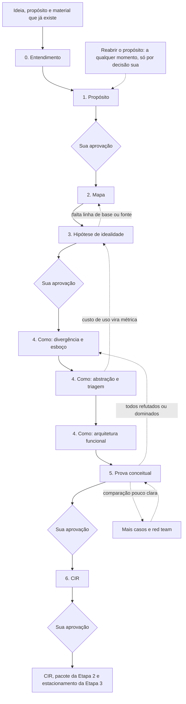
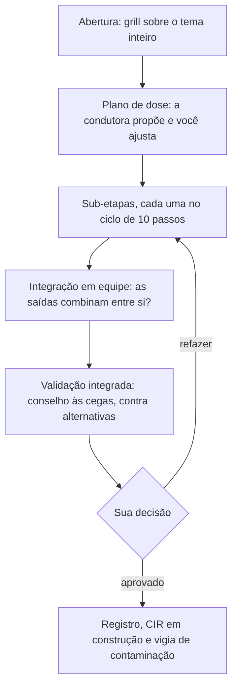
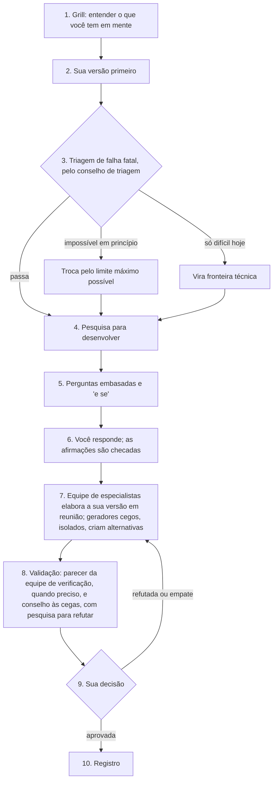

# Fluxograma completo — Etapa 1 (método IDEAL em ciclo)

<aside>
🔁

**O que é:** o passo a passo completo da Etapa 1. O ciclo do [Fluxograma aperfeiçoado — Etapa 1 (CIR)](Fluxograma%20aperfei%C3%A7oado%20%E2%80%94%20Etapa%201%20(CIR)%20fb9015a39bb1406481763a2903aca006.md) fica no centro, e cada passo do [Etapa 1 — Concepção Ideal da Solução: método IDEAL (v2)](../../Etapa%201%20%E2%80%94%20Concep%C3%A7%C3%A3o%20Ideal%20da%20Solu%C3%A7%C3%A3o%20m%C3%A9todo%20IDEAL%20%20629394b6e12b49c792805775c07e27d3.md) vira uma ou mais sub-etapas. Toda sub-etapa passa pelo mesmo ciclo de entendimento e validação, na dose que a importância dela pede.

**Já inclui as suas decisões:** os temas 1, 3, 5 e 6 só avançam com a sua aprovação; o modelo decide quantas perguntas fazer, quais e como; Claude primeiro em todos os papéis, no modelo que você escolher para cada um; e o critério máximo é a ideia melhor, mais criativa e eficaz, antes do custo, sem desperdício. As skills que executam este fluxograma estão no [Plano geral das skills — Etapa 1 (CIR)](Plano%20geral%20das%20skills%20%E2%80%94%20Etapa%201%20(CIR)%2072d0fdc1db19433e9101d1ac3b3015ef.md). Esta versão já inclui as equipes de especialistas que conversam entre si (seção 2.5).

</aside>

## 1. Visão geral

| Tema | Fase e passo do IDEAL | Sub-etapas | Trava |
| --- | --- | --- | --- |
| 0. Entendimento | Pré-requisito | 0.1 a 0.3 | Não: você confirma a ficha |
| 1. Propósito | I, passo 1 | 1.1 a 1.7 | **Sim** |
| 2. Mapa | D, passo 2 | 2.1 a 2.7 | Não |
| 3. Hipótese de idealidade | D, passo 3 | 3.1 a 3.6 | **Sim** |
| 4. Como | E e A, passos 4 a 7 | 4.1 a 4.15 | Não, mas a classificação dos elementos e a escolha das famílias passam sempre pelo conselho |
| 5. Prova conceitual | L, passo 8 | 5.1 a 5.7 | **Sim** |
| 6. CIR | L, passo 9 | 6.1 a 6.6 | **Sim** |

**Trava** quer dizer que o tema só avança com a sua aprovação. Nos temas sem trava, você pode pular uma sub-etapa; o registro guarda o que foi pulado e o risco. Se o que foi pulado for exigido pelo critério de pronto, volta como pendência no tema 6.

## 2. O ciclo

### 2.1 Em dois níveis

- **No tema:** um grill sobre o tema inteiro, o plano de dose de cada sub-etapa, as sub-etapas, a integração das saídas, numa reunião da equipe, uma validação integrada e a sua decisão. A validação integrada pega o que a validação por partes não vê: peças boas que não combinam entre si.
- **Na sub-etapa:** o ciclo de 10 passos do fluxograma aperfeiçoado, na dose certa.

### 2.2 O ciclo de cada sub-etapa

1. **Grill.** Sempre, em todo tema e sub-etapa. O modelo decide quantas perguntas fazer, quais e como; cada sub-etapa define só o que o grill precisa entender. As perguntas fazem refletir, trazem base e nunca sugerem resposta.
2. **Sua versão primeiro.** Você escreve antes de ver qualquer ideia da IA, porque quem vê um exemplo antes tende a copiá-lo ([Jansson e Smith](https://doi.org/10.1016/0142-694X%2891%2990003-F)). Se você não tiver uma, a IA propõe várias, nunca uma só.
3. **Triagem de falha fatal.** É a validação antes de elaborar, feita pelo conselho de triagem. Só checa o que a Etapa 1 preserva: lógica, matemática e ciência; natureza humana; propósito e valores. Roda quando a sub-etapa produz algo que pode ser impossível em princípio ou ferir valores. Nada é descartado.
4. **Pesquisa para desenvolver.** Sempre na web e em artigos de ciência, matemática e engenharia: o que fortalece, amplia ou corrige a sua versão.
5. **Perguntas embasadas.** Saem da pesquisa, com fonte e explicação, incluindo "e se" e contraexemplos.
6. **Você responde.** Cada afirmação é checada contra as fontes. Se uma contradiz a evidência, a IA mostra a evidência e pergunta de novo.
7. **Elaboração e alternativas.** Uma equipe de especialistas, com um crítico, desenvolve em reunião a melhor versão da sua (seção 2.5). Geradores cegos, isolados e sem vê-la, criam alternativas com princípios diferentes.
8. **Validação.** O conselho recebe H1, H2, H3… sem autoria e com o critério de refutação escrito antes (o "refuta se" de cada sub-etapa). Cada membro pesquisa para derrubar, pela sua ótica, e julga sozinho. Quando o "refuta se" exige combinar especialidades, uma equipe de verificação, que não elaborou a versão, entrega antes um parecer técnico; o veredito continua com o conselho.
9. **Sua decisão.** Escolher, combinar ou pedir outra rodada.
10. **Registro.** Decisão, alternativas, evidência, dissenso, confiança e o que reverteria a decisão. A vigia de contaminação roda a cada registro.

### 2.3 Dose

A dose responde a três perguntas: quanto esta saída muda o CIR, quanta incerteza há e quão difícil é reverter depois. É a lógica do valor da informação: vale investigar mais onde a resposta pode mudar uma decisão importante ([Howard](https://doi.org/10.1109/TSSC.1966.300074)). Como custo não é limite, a dose padrão e a completa são a regra, e a leve fica para o que tem pouco a decidir. A eficiência vem de não repetir o que não muda a decisão.

| Passo do ciclo | Leve | Padrão | Completa |
| --- | --- | --- | --- |
| 1. Grill | Sempre; o modelo decide quantas perguntas | Sempre | Sempre, até não restar dúvida que mude a decisão |
| 2. Sua versão | Rascunho ou "não tenho" | Sim | Sim, por escrito, antes de qualquer ideia da IA |
| 3. Triagem | 1 membro e o crítico, quando houver algo que possa ser fatal | 2 membros e o crítico, quando houver algo que possa ser fatal | 2 ou 3 membros e o crítico, sempre |
| 4. Pesquisa | 1 pesquisador, focal | 2 ou 3 pesquisadores | 3 a 5 em paralelo, com a busca a favor e a busca contra separadas |
| 5 e 6. Perguntas e respostas | Só se a pesquisa trouxer algo que mude a decisão | Sim | Sim, com "e se" e contraexemplos |
| 7. Elaboração e alternativas | 1 especialista sozinho propõe várias variações | Equipe de 3 especialistas e o crítico, em 2 rodadas, e 1 gerador cego | Equipe de 3 a 5 especialistas e o crítico, em até 3 rodadas, com reuniões paralelas e fusão quando a saída é central, e 2 ou 3 geradores cegos, cada um com operadores diferentes |
| 8. Validação | Conselho rápido, 1 rodada | Conselho rápido, com rodada 2 se houver divergência | Conselho completo, com o parecer da equipe de verificação quando o "refuta se" pede |
| 9. Decisão | Pode aprovar em lote | Sim | Sim; trava nos temas 1, 3, 5 e 6 |
| 10. Registro | Uma linha | Registro curto | Registro completo |
- **Sobe uma dose quando:** o conselho diverge num critério relevante; a triagem acha uma possível falha fatal; uma resposta sua contradiz a evidência; a saída alimenta muitas sub-etapas seguintes; ou você pede.
- **Desce uma dose quando:** a saída é descritiva, já tem fonte e passou na validação sem ressalvas.
- **Quem define:** a condutora propõe a dose de cada sub-etapa no começo do tema, e você ajusta.

### 2.4 Conselhos

| Conselho | Quando | Composição |
| --- | --- | --- |
| De triagem | Passo 3, antes de elaborar | Refutador de limites teóricos e guardião, mais natureza humana quando há pessoas no centro, e o crítico. Uma rodada; só procura falha fatal |
| Rápido | Passo 8, nas doses leve e padrão | 2 membros com as óticas do template e o crítico. Rodada 2 só se houver divergência |
| Completo | Passo 8 na dose completa e validações integradas | De 3 a 5 membros com óticas diferentes e o crítico, às cegas. Rodada 2 só se houver divergência |

| Template | Usado em | Óticas |
| --- | --- | --- |
| Propósito | Tema 1 | Guardião, natureza humana, refutador e explorador |
| Evidência | Tema 2 e linhas de base | Refutador de método, especialista do domínio e construtivo (o que falta) |
| Idealidade | Tema 3 e RFI na função | Refutador de limites teóricos, construtivo, natureza humana e explorador |
| Diversidade | Famílias (4.5) | Juiz de diversidade que não gerou nada e explorador |
| Elementos | Conflitos e classificação (4.7 e 4.9) | Construtivo, adversário e guardião |
| Arquitetura | 4.11 a 4.15 | Construtivo, refutador de coerência e adversário |
| Prova | Tema 5 | Adversário, refutador, natureza humana, construtivo e explorador |
| Passagem | Tema 6 | Leitor da Etapa 2 sem contexto e guardião do propósito |
| Sob demanda | Quando você pedir no chat | Escolhidas pela condutora conforme a dúvida |

Regras novas, além das da seção 6 do fluxograma aperfeiçoado:

- **Famílias de modelos diferentes, de qualidade parecida.** Um painel de modelos diferentes avalia melhor que um modelo só ([PoLL](https://arxiv.org/abs/2404.18796)), mas misturar modelos de qualidade desigual baixa a média ([Self-MoA](https://arxiv.org/abs/2502.00674)).
- **Crítico numa sessão separada,** que não produziu o artefato nem sabe quem o produziu: avaliadores de IA reconhecem e favorecem as próprias gerações ([Panickssery, Bowman e Feng](https://arxiv.org/abs/2404.13076)). Na fase 10 do plano geral, o teste diz se um crítico de outra família rende mais.
- **Ordem das hipóteses sorteada para cada membro,** porque juízes de IA têm viés de posição ([Zheng et al.](https://arxiv.org/abs/2306.05685)).
- **Quem gera não avalia o que gerou.** Num estudo com mais de 100 pesquisadores, modelos se mostraram avaliadores pouco confiáveis de ideias ([Si, Yang e Hashimoto](https://arxiv.org/abs/2409.04109)).

### 2.5 Equipes de especialistas

Para elaborar e para verificar o que exige mais de uma especialidade, os especialistas trabalham em equipe e conversam entre si; para gerar alternativas e para julgar, continuam isolados. A divisão segue a evidência: pessoas que geram ideias separadas produzem mais que grupos que geram conversando ([Diehl e Stroebe](https://doi.org/10.1037/0022-3514.53.3.497)), e uma equipe de agentes de IA em reuniões estruturadas juntou especialidades num resultado validado em laboratório ([Swanson et al., Nature](https://doi.org/10.1038/s41586-025-09442-9)).

| Equipe | Quando | Composição |
| --- | --- | --- |
| De elaboração | Passo 7, nas doses padrão e completa | Líder, especialistas da sub-etapa e o crítico. Na dose padrão, 3 especialistas e 2 rodadas; na completa, de 3 a 5 e até 3 rodadas, com reuniões paralelas e fusão quando a saída é central |
| De verificação | Passo 8, quando o "refuta se" exige combinar especialidades | Especialistas que não elaboraram a versão e o crítico. Entregam um parecer técnico, com cálculos e fontes; o veredito continua com o conselho |
| De integração | Fim de cada tema | A equipe do tema e o crítico. Conferem se as saídas combinam entre si, antes da validação integrada |
- **Cada um se prepara sozinho antes da reunião,** para que o que só um sabe não se perca na conversa ([Stasser e Titus](https://doi.org/10.1037/0022-3514.48.6.1467)).
- **Pauta escrita e rodadas em ordem.** Cada especialista fala na sua vez, discorda quando tem motivo e diz "passo" quando não tem nada novo; o crítico fala ao fim de cada rodada.
- **Na sua área, o especialista só é contrariado com contraprova:** fonte, cálculo ou contraexemplo. Sem essa regra, equipes de IA ficam abaixo do seu melhor membro, porque fazem média das opiniões ([Pappu et al.](https://arxiv.org/abs/2602.01011)).
- **Contas e simulações rodam em Python,** e o resultado entra na ata.
- **O líder sintetiza sem fazer média** e registra o dissenso e o que mudaria a decisão.
- **Os membros se conhecem pela especialidade, não pelo modelo.** Na v1, todos são Claude, com óticas diferentes; outras famílias só onde o teste mostrar necessidade.

### 2.6 O que vale o tempo todo

| Mecanismo | O que faz |
| --- | --- |
| Dossiê e CIR em construção | Cada sub-etapa grava a saída e preenche a seção do CIR de onde ela vem (seção 4) |
| Banco de ideias | Ideia de solução que aparece antes do tema 4 entra com origem e tema, e espera. Nada se perde, e nada é trabalhado fora de hora |
| Fronteiras técnicas e estacionamento | O que é de Etapa 2 ou 3 vai para a lista certa assim que aparece |
| Fichas de fonte | Toda fonte aberta vira uma ficha, com o trecho que sustenta a afirmação, e é reaproveitada por todos |
| Vigia de contaminação | A cada registro, procura os sinais do v2: preço, cliente pagante, plano, tela ou MVP; escolha de tecnologia; "dá para fazer?" ou "alguém pagaria?" como critério; uma ideia só; promessa absoluta sem métrica; CIR que cresce por atração; experiência descrita como tela; propósito que muda sem registro |
| Propósito congelado | Depois do 1.7, só muda por decisão sua. A condutora lista tudo o que deriva dele e marca para revisão |
| Avaliar antes de gerar mais | Se a comparação não fica clara, melhora-se a avaliação antes de gerar mais ideias |
| Regra de parada | Uma rodada que não traz família nova nem muda o CIR encerra a divergência ou a convergência |
| Conselho sob demanda | Você chama no chat quando quiser, e a condutora escolhe o template |
| Atalho com hipótese pronta | Grill curto e ciclo a partir da triagem; as alternativas continuam, porque sem elas não há com o que comparar |

## 3. Passo a passo completo

**Como ler:** em cada sub-etapa, **o quê** traz o objetivo e as ferramentas do v2; **grill quer entender** é o objetivo das perguntas, e o modelo decide quais fazer; **pesquisa** é o que buscar; **você, especialistas e alternativas** cobre os passos 2 e 7 do ciclo (nas doses padrão e completa, "especialistas" é uma equipe em reunião, seção 2.5; geradores cegos e classificadores trabalham sempre isolados); **validação** diz qual conselho valida e o **refuta se**, o critério escrito antes; **sai** é a saída. Onde não há pesquisa própria, a pesquisa é de conferência: toda afirmação nova é checada. A dose está no título; "nova" marca o que não existia no v2.

### Tema 0 — Entendimento

**Abertura:** entender a ideia, por que ela importa para você, o que já existe e como você prefere trabalhar.

#### 0.1 Ficha do projeto · dose padrão

- **O quê:** a ideia e o propósito nas suas palavras, o que já existe, o que já está decidido e o que está aberto.
- **Grill quer entender:** a ideia e o motivo dela; o vocabulário que você usa; o que você não aceitaria de jeito nenhum; o que faria esta etapa valer a pena.
- **Pesquisa:** uma visão geral do tema, para o grill não perguntar o óbvio, e as fontes que você citar.
- **Validação:** o crítico confere se a ficha reflete as suas palavras, sem interpretação. **Refuta se:** você não reconhece a sua ideia ou falta algo que você disse.
- **Sai:** a ficha do projeto, confirmada por você.

#### 0.2 Separação do material por etapa · dose padrão · nova

- **O quê:** classificar o que já existe (documentos, decisões e ideias) em Etapa 1, 2 ou 3, como o v2 fez com o Motor de Insights na seção 11.
- **Grill quer entender:** a situação de cada material (rascunho, decidido ou só inspiração) e o que você considera intocável.
- **Pesquisa:** conferir as afirmações centrais do material que vão alimentar o mapa.
- **Você, especialistas e alternativas:** dois classificadores, um sem ver o outro; as divergências vão para você.
- **Validação:** conselho rápido (guardião e refutador), com os sinais de contaminação. **Refuta se:** um trecho de Etapa 2 ou 3 ficou como Etapa 1, ou uma ideia de solução virou requisito.
- **Sai:** o que é de Etapa 1 alimenta os temas 1 a 3; o de Etapa 2 vira fronteira técnica; o de Etapa 3 vai para o estacionamento; ideias de solução vão para o banco, com a origem "material existente".

#### 0.3 Preparação · dose leve

- **O quê:** os modelos disponíveis para o conselho, onde fica o dossiê, as doses padrão e como retomar entre sessões.
- **Grill quer entender:** que modelo Claude usar em cada papel, pelo orçamento de tokens ou pela complexidade; quanto de cada sessão você quer acompanhar.
- **Sai:** o estado inicial do dossiê e o mapa de modelos por papel.

### Tema 1 — Propósito (passo 1) · com trava

**Abertura:** para que a ideia deve existir, na vida de quem, e o que é inegociável para você.

#### 1.1 Escada do para quê · dose completa

- **O quê:** subir da ideia, que é um meio, até um resultado na vida de alguém. Pare quando a resposta seguinte já for genérica demais para orientar escolhas ("ser feliz").
- **Grill quer entender:** por que você quer isso, que resultado você imagina e em que degrau acha que está o propósito.
- **Pesquisa:** o que a ciência diz que de fato produz o resultado de cada degrau.
- **Você, especialistas e alternativas:** você monta a sua escada; especialistas a completam; geradores cegos montam escadas a partir das partes afetadas e do fenômeno.
- **Validação:** conselho de triagem e conselho rápido Propósito. **Refuta se:** o degrau escolhido é meio (existe outro caminho para o mesmo resultado) ou genérico demais (não ajuda a escolher entre duas soluções).
- **Sai:** a escada, com o degrau candidato sem meio, produto ou tecnologia.
- **Ex.:** "analisar dados e eliminar vieses" é meio; o degrau candidato é "decidir melhor e mais cedo, com evidência".

#### 1.2 Formulações alternativas e escolha · dose completa

- **O quê:** de 3 a 5 versões do propósito e a escolha de uma. As outras podem virar outros CIRs.
- **Grill quer entender:** qual é mais sua e por quê; o que cada uma deixa de fora.
- **Pesquisa:** para cada formulação, o que a evidência diz sobre o resultado que ela persegue e onde ela conflita com valores.
- **Você, especialistas e alternativas:** você escreve as suas; geradores cegos escrevem outras; especialistas refinam todas.
- **Validação:** conselho completo Propósito, às cegas (P1, P2, P3…). **Refuta se:** mistura dois propósitos, cita meio ou produto, ou não ajuda a escolher entre duas soluções.
- **Sai:** o propósito escolhido, com as formulações descartadas e o motivo (CIR, seção 2).

#### 1.3 Job · dose padrão

- **O quê:** o job em verbo, objeto e contexto, estável no tempo e independente de solução (JTBD).
- **Grill quer entender:** quem executa o job hoje, como e quando, e o que o torna difícil.
- **Pesquisa:** como o job é executado de fato (estudos de observação e relatos de prática), para não ficar num job imaginado "de sala de reunião".
- **Você, especialistas e alternativas:** 2 ou 3 formulações e o teste de estabilidade: faria sentido há 50 anos e daqui a 50?
- **Validação:** conselho rápido (natureza humana e refutador). **Refuta se:** cita uma solução, muda se a tecnologia mudar ou não tem contexto.
- **Sai:** o job (CIR, seção 2).

#### 1.4 Mapa de partes · dose completa

- **O quê:** quem executa o job, quem é afetado direta e indiretamente e quem tenta distorcer. Sempre papéis, nunca personas; as partes indiretas vêm do Value Sensitive Design.
- **Grill quer entender:** quem você vê em volta do job, quem perde se ele funcionar e quem ia querer que ele falhasse.
- **Pesquisa:** as partes do fenômeno, os incentivos de cada uma e casos de manipulação.
- **Você, especialistas e alternativas:** geradores cegos mapeiam as partes a partir de disciplinas diferentes (economia, sociologia e segurança, por exemplo).
- **Validação:** conselho rápido (adversário e guardião). **Refuta se:** falta uma parte que mudaria o desenho, ou aparece segmento ou comprador no lugar de papel.
- **Sai:** o mapa de partes, com o interesse de cada uma e como pode ser afetada.
- **Ex.:** quem decide, quem analisa, o público observado e quem tenta manipular a conversa.

#### 1.5 Valores e linhas vermelhas · dose completa · nova

- **O quê:** tornar explícitos os valores que são restrições preservadas, ou seja, o que a solução nunca pode fazer, mesmo funcionando. Sem eles, a triagem de falha fatal não tem critério.
- **Grill quer entender:** o que você não aceitaria mesmo que funcionasse e como decidir quando dois valores conflitam (ex.: privacidade × antecipação).
- **Pesquisa:** danos conhecidos de soluções parecidas e consequências não intencionais (consequence scanning).
- **Você, especialistas e alternativas:** especialistas derivam linhas vermelhas do mapa de partes; geradores cegos procuram consequências não intencionais.
- **Validação:** conselho rápido (guardião e natureza humana). **Refuta se:** um valor não pode ser testado num caso concreto, ou dois valores conflitam sem regra de prioridade.
- **Sai:** valores testáveis ("toda manipulação detectável é identificada e rotulada") e candidatas a restrições anti-ideais (CIR, seções 5 e 9).

#### 1.6 Estado ideal · dose completa

- **O quê:** o mundo quando o job é feito com perfeição. Ferramentas: "destruído ontem à noite" (se tudo o que existe para esse job sumisse, o que você poria no lugar?), a notícia do futuro, sem preço, lançamento nem cliente, e o que passa a ser possível que hoje não é.
- **Grill quer entender:** o que você poria no lugar e o que muda na vida das partes.
- **Pesquisa:** limites conhecidos, para separar o possível, orientado pelo preferível, do absurdo, que só vale como provocação (cone de Voros).
- **Você, especialistas e alternativas:** você escreve a sua notícia; geradores cegos escrevem outras; especialistas elaboram.
- **Validação:** conselho de triagem e conselho rápido Propósito. **Refuta se:** descreve funções, telas ou produto em vez de resultados, ou viola uma restrição preservada.
- **Sai:** o estado ideal e a notícia do futuro (CIR, seção 2).

#### 1.7 Congelamento do propósito · validação integrada · trava

- **O quê:** propósito, job, partes, valores e estado ideal, coerentes entre si.
- **Validação:** conselho completo Propósito, às cegas, sobre o pacote do tema contra 2 ou 3 pacotes alternativos montados por geradores cegos. **Refuta se:** as peças se contradizem ou um pacote alternativo vence no conjunto.
- **Sai:** a declaração de propósito congelada e o primeiro registro de decisão. Reabrir é decisão sua, com registro e revisão de tudo o que deriva dele.

### Tema 2 — Mapa (passo 2)

**Abertura:** o que você já sabe do fenômeno, onde acha que o job falha e em que fontes confia. É pesquisa sobre o fenômeno, não sobre o mercado: observar como as pessoas executam o job é desejável; perguntar quanto pagariam, não.

#### 2.1 Job map · dose padrão

- **O quê:** as 8 etapas universais do job: definir, localizar, preparar, confirmar, executar, monitorar, modificar e concluir (Bettencourt e Ulwick).
- **Grill quer entender:** como você executa, ou vê executarem, cada etapa.
- **Pesquisa:** como pessoas, instituições e ferramentas executam cada etapa hoje.
- **Você, especialistas e alternativas:** especialistas montam o mapa; um gerador cego monta outra decomposição, para revelar etapas escondidas.
- **Validação:** conselho rápido Evidência. **Refuta se:** uma etapa não tem evidência de como é feita hoje, ou a decomposição esconde uma etapa com falha conhecida.
- **Sai:** o job map (CIR, seção 3).

#### 2.2 Falhas e causas · dose completa

- **O quê:** em cada etapa, onde e por que as abordagens atuais falham, com árvore de causas ou 5 porquês.
- **Grill quer entender:** onde você vê falhas e o que acha que causa cada uma.
- **Pesquisa:** de 3 a 5 pesquisadores, um por especialidade, com a busca a favor e a busca contra feitas por agentes separados.
- **Você, especialistas e alternativas:** especialistas elaboram as árvores; geradores cegos propõem causas concorrentes, como na análise de hipóteses concorrentes (Heuer). Uma equipe de verificação, com especialistas que não elaboraram as árvores, testa as causas concorrentes contra a evidência e entrega um parecer ao conselho.
- **Validação:** conselho completo Evidência. **Refuta se:** a falha persiste onde a causa está ausente, ou a causa só tem correlação como evidência.
- **Sai:** falhas, causas e a força da evidência de cada uma; o que não tem fonte fica marcado como hipótese.

#### 2.3 Contradições e trade-offs aceitos · dose completa

- **O quê:** "para melhorar A, piora B" (TRIZ) e os trade-offs que todos aceitam como inevitáveis.
- **Grill quer entender:** que trade-offs você considera inevitáveis e por quê.
- **Pesquisa:** no modo refutar, se cada contradição é de princípio (teorema ou lei) ou só das abordagens atuais.
- **Você, especialistas e alternativas:** listas independentes; especialistas escrevem cada contradição como um par de parâmetros.
- **Validação:** conselho de triagem. **Refuta se:** uma contradição "de princípio" tem contraexemplo, ou uma "quebrável" tem prova de impossibilidade.
- **Sai:** as contradições de princípio viram restrições preservadas; as quebráveis viram desafios do tema 4 (CIR, seções 3 e 5).
- **Ex.:** três critérios intuitivos de "sem viés" não valem ao mesmo tempo, salvo em casos especiais ([Kleinberg, Mullainathan e Raghavan](https://arxiv.org/abs/1609.05807)); já volume × profundidade é só das abordagens atuais.

#### 2.4 Projeção de referência · dose padrão

- **O quê:** o que acontece se nada mudar (Ackoff).
- **Grill quer entender:** o que você acha que vai acontecer e com base em quê.
- **Pesquisa:** tendências do fenômeno, não do mercado.
- **Validação:** conselho rápido (refutador e especialista do domínio). **Refuta se:** a tendência não tem fonte ou depende de preço e adoção.
- **Sai:** a projeção de referência (CIR, seção 3).

#### 2.5 Espaço K · dose completa

- **O quê:** o mapa de conhecimento da teoria C–K: literatura, casos análogos de outras áreas e limites conhecidos, separados em sabido, incerto e impossível de saber.
- **Grill quer entender:** o que você toma como sabido e em que fontes confia.
- **Pesquisa:** de 3 a 5 pesquisadores em paralelo, um por especialidade, com analogias de outras áreas buscadas pela função, e não pela aparência ([Kittur et al.](https://doi.org/10.1073/pnas.1807185116)).
- **Validação:** conselho completo Evidência, com o crítico conferindo cada fonte. **Refuta se:** o trecho da fonte não sustenta a afirmação, ou um limite da tecnologia atual foi registrado como impossibilidade.
- **Sai:** o mapa de conhecimento. Teoremas e leis viram restrições preservadas; limites da tecnologia atual, fronteiras técnicas; lacunas, perguntas científicas em aberto (CIR, seções 3, 5 e 15).

#### 2.6 Banco de casos · dose completa · nova

- **O quê:** juntar situações reais passadas, com desfecho conhecido, antes de existir qualquer solução. Escolher os casos antes evita escolher os que favorecem a solução, a mesma lógica do pré-registro ([Nosek et al.](https://doi.org/10.1073/pnas.1708274114)).
- **Grill quer entender:** que casos você conhece e quais seriam os mais difíceis para qualquer solução.
- **Pesquisa:** casos documentados, com fonte, incluindo casos de simetria (mesmos dados, lados trocados), casos em que a evidência contrária era a mais importante e casos em que o certo era dizer "nada relevante".
- **Você, especialistas e alternativas:** pesquisadores independentes, para variar os tipos de caso.
- **Validação:** conselho rápido Evidência, com o crítico conferindo fatos e desfechos. **Refuta se:** o desfecho não é verificável, ou faltam casos de simetria, de evidência contrária e de "nada relevante".
- **Sai:** de 15 a 30 casos candidatos, com fonte, desfecho e o motivo de serem difíceis.
- **Ex.:** no Motor de Insights, os casos do Anexo A.

#### 2.7 Especialistas e conselhos do projeto · dose padrão

- **O quê:** a partir do mapa, as especialidades das equipes e a composição de cada template do conselho, com a skill de especialidade e o modelo de cada membro; especialidade sem skill fica marcada e vira lacuna.
- **Grill quer entender:** que especialidades e escolas de pensamento você quer ouvir, ou evitar.
- **Pesquisa:** que disciplinas estudam cada causa e cada contradição.
- **Validação:** conselho rápido (explorador e construtivo). **Refuta se:** uma causa ou contradição fica sem especialidade, ou dois membros repetem a mesma ótica.
- **Sai:** os especialistas e os conselhos do projeto.

**Validação integrada do tema:** conselho completo Evidência sobre o mapa inteiro: cada falha tem causa, cada causa tem evidência e cada contradição está classificada.

### Tema 3 — Hipótese de idealidade (passo 3) · com trava

**Abertura:** como você saberia que o job foi feito com perfeição.

#### 3.1 Resultados desejados · dose completa

- **O quê:** desired outcome statements (ODI): direção, métrica, objeto e contexto, sem solução, para cada etapa do job map e levados ao limite.
- **Grill quer entender:** o que "perfeito" quer dizer para você em cada etapa.
- **Pesquisa:** como o campo mede sucesso (ex.: calibração de probabilidades pelo escore de Brier).
- **Você, especialistas e alternativas:** você escreve os seus; especialistas completam; geradores cegos escrevem conjuntos independentes.
- **Validação:** conselho rápido Idealidade. **Refuta se:** contém solução, não é mensurável ou muda com a tecnologia.
- **Sai:** os resultados desejados por etapa.

#### 3.2 Efetividade, custo de uso e dano · dose completa

- **O quê:** medidas de efetividade (MOEs, da NASA e do INCOSE) do ponto de vista de quem tem o job; custo de uso (esforço, tempo e atenção) e danos a terceiros. É por aqui que a experiência entra no CIR. As medidas técnicas (MOPs e TPMs) ficam para a Etapa 2.
- **Grill quer entender:** o que pesa mais para quem executa o job e que danos você teme.
- **Pesquisa:** evidência de custo cognitivo e de dano, como o viés de automação (Parasuraman e Manzey).
- **Validação:** conselho rápido (natureza humana e guardião). **Refuta se:** uma métrica mede o sistema, e não o resultado de quem tem o job, ou faltam custo de uso e dano.
- **Sai:** as métricas de efetividade, custo de uso e dano.

#### 3.3 Linha de base e limite ideal · dose completa

- **O quê:** para cada métrica, a linha de base atual (com fonte, ou "a medir" com o método) e o limite ideal (tempo, erro e esforço tendendo a zero).
- **Grill quer entender:** onde você acha que a linha de base está hoje.
- **Pesquisa:** valores medidos na literatura.
- **Validação:** conselho rápido Evidência. **Refuta se:** a linha de base não tem fonte nem método, ou o limite não é o extremo.
- **Sai:** a tabela de métricas, linhas de base e limites (CIR, seção 4).

#### 3.4 RFI do todo e de cada etapa · dose completa

- **O quê:** o Resultado Final Ideal do TRIZ: o job se realiza "sozinho", com todos os benefícios e nenhum custo nem dano. Um para o todo e um para cada etapa do job map.
- **Grill quer entender:** como seria se não houvesse sistema nenhum.
- **Pesquisa:** onde, em outros domínios, um job parecido já se realiza sozinho.
- **Você, especialistas e alternativas:** você escreve o seu RFI; geradores cegos escrevem outros.
- **Validação:** conselho rápido Idealidade, às cegas. **Refuta se:** o RFI pressupõe um meio ou não corresponde a uma etapa do job map.
- **Sai:** os RFIs (CIR, seção 4).

#### 3.5 Teste do impossível · dose completa

- **O quê:** para cada limite e RFI, separar o impossível em princípio, que troca pelo limite máximo possível com a fonte, do que é só difícil hoje, que vira fronteira técnica (tabela da seção 3.2 do v2). As leis do domínio (físicas, lógicas, estatísticas e cognitivas) ficam explícitas.
- **Grill quer entender:** que limites você considera inegociáveis e por quê.
- **Pesquisa:** no modo refutar, provas de impossibilidade e limites estatísticos, computacionais e físicos.
- **Validação:** parecer de uma equipe de verificação (matemática, física ou engenharia, e computação), seguido do conselho de triagem reforçado, com dois refutadores de óticas diferentes. **Refuta se:** um alvo depende de algo impossível em princípio e não foi reformulado, ou algo só difícil foi tratado como impossível.
- **Sai:** os limites reformulados e as fronteiras técnicas (CIR, seção 5, e pacote da Etapa 2).
- **Ex.:** "prever o futuro" vira "probabilidades calibradas, com a maior resolução que a evidência permite"; "eliminar todo viés" vira calibração e simetria.

#### 3.6 Métricas, critério de refutação e casos congelados · validação integrada · trava

- **O quê:** escolher de 5 a 12 métricas de idealidade, cada uma com linha de base e limite; escrever o critério de refutação da prova, ou seja, o que contaria como fracasso no tema 5; e congelar os casos: de 10 a 20 de trabalho e cerca de um terço a mais de reservados, que nenhum gerador vê até o tema 5.
- **Validação:** conselho completo Idealidade, às cegas, contra conjuntos alternativos de métricas e RFIs. **Refuta se:** as métricas não distinguem conceitos diferentes, não cobrem custo de uso e dano, ou o critério de refutação não tem como falhar.
- **Sai:** a hipótese de idealidade aprovada (CIR, seções 4, 5 e 12).

### Tema 4 — Como (passos 4 a 7)

**Abertura:** as ideias que você já tem, por que acha que funcionariam e o que acha que ninguém tentou. O tema não tem trava, mas a classificação dos elementos (4.9) e a escolha das famílias que seguem (4.11) passam sempre pelo conselho.

**Passo 4 do IDEAL — Divergência**

#### 4.1 Sua geração primeiro · dose padrão

- **O quê:** você registra as suas ideias, mais as que entraram no banco nos temas anteriores, antes de ver qualquer ideia da IA. O banco guarda a origem de cada uma, porque a IA aumenta a criatividade de cada pessoa, mas deixa os resultados mais parecidos entre si ([Doshi e Hauser](https://doi.org/10.1126/sciadv.adn5290)).
- **Grill quer entender:** o princípio por trás de cada ideia e que etapa do job map ela resolve.
- **Pesquisa:** o que já existe de parecido com cada ideia, para achar onde ela é nova.
- **Validação:** conselho de triagem, ideia a ideia; nada é descartado.
- **Sai:** as suas ideias no banco, com a origem.

#### 4.2 Desafios de geração · dose padrão · nova

- **O quê:** transformar o diagnóstico em alvos. Cada contradição quebrável, cada causa de falha e cada RFI por etapa vira um "como poderíamos…" sem meio embutido. É a ponte entre o diagnóstico e a exploração.
- **Grill quer entender:** que desafios você acha mais importantes e por quê.
- **Pesquisa:** se algum desafio já foi resolvido em outro campo.
- **Validação:** conselho rápido (explorador e construtivo). **Refuta se:** o desafio embute um meio ("como fazer um dashboard que…").
- **Sai:** os desafios, priorizados pelo efeito nas métricas.

#### 4.3 Divergência no núcleo, com cerca de 70% do esforço · dose completa

- **O quê:** famílias de conceito para os desafios do núcleo: os meios do propósito e a cadeia até o resultado.
- **Ferramentas:** partições expansivas (C–K); princípios inventivos e de separação (TRIZ); matriz morfológica (Zwicky); operadores do SIT ([Goldenberg, Mazursky e Solomon](https://doi.org/10.1126/science.285.5433.1495)); níveis de intervenção de [Meadows](https://donellameadows.org/archives/leverage-points-places-to-intervene-in-a-system/) (parâmetros, fluxos, regras, metas e paradigma); analogias próximas, moderadas e distantes, buscadas pela função ([Chan, Dow e Schunn](https://doi.org/10.1016/j.destud.2014.08.001); [Fu et al.](https://doi.org/10.1115/1.4023158)); inversão; 10×; provocações.
- **Como:** geradores independentes, cada um com operadores diferentes e sem ver o banco. Cada gerador lista várias ideias com a probabilidade de cada uma, incluindo as improváveis ([Verbalized Sampling](https://arxiv.org/abs/2510.01171)). De 20 a 30 ideias por rodada, sem parar na primeira lista.
- **Grill quer entender:** onde você sente que ainda falta ousadia e que pressupostos quer quebrar.
- **Pesquisa:** mecanismos reais de outras disciplinas para cada desafio.
- **Validação:** conselho de triagem, ideia a ideia; nada é descartado.
- **Sai:** o banco de ideias do núcleo.

#### 4.4 Tangentes, com cerca de 30% do esforço · dose padrão

- **O quê:** experiência, enfeites, necessidades vizinhas, analogias abstratas e provocações. Tangente é aposta: só compensa se, abstraída no 4.8, virar função. A fração se ajusta pela taxa de surpresa (4.10).
- **Como:** geradores separados dos do núcleo.
- **Grill quer entender:** que experiência você imagina e que necessidades vizinhas enxerga.
- **Validação:** no 4.9, junto com o resto do banco.
- **Sai:** as tangentes no banco.

#### 4.5 Famílias e fichas · dose completa

- **O quê:** agrupar as ideias por princípio de solução, com uma ficha por família: princípio central, como realiza o job, contradições que quebra, métricas que move e perguntas de conhecimento que abre.
- **Grill quer entender:** que família você acha mais promissora e por quê.
- **Pesquisa:** evidência para o princípio central de cada família.
- **Validação:** conselho rápido Diversidade. Um juiz que não gerou nada compara as famílias, duas a duas e sem autoria. **Refuta se:** duas famílias têm o mesmo princípio central, ou há menos de 3 realmente diferentes.
- **Sai:** o portfólio de famílias (CIR, seção 6). Uma rodada que não traz família nova encerra a divergência.

**Passo 5 do IDEAL — Esboço integrado**

#### 4.6 Esboço integrado · dose padrão

- **O quê:** de 1 a 2 páginas descrevendo o conceito como se tudo do banco coubesse nele: núcleo, cadeia até o resultado, experiência, enfeites e necessidades vizinhas. Curto de propósito: na simulação do v2, o esboço curto rendeu mais por dia do que elaborar tudo.
- **Grill quer entender:** como você imagina as peças funcionando juntas.
- **Validação:** junto com o 4.7.
- **Sai:** o esboço, que é rascunho e não compromisso.

#### 4.7 Conflitos, sinergias e dependências · dose completa

- **O quê:** elementos que pioram outros ou o propósito; elementos que, juntos, fazem o que nenhum faz sozinho; o que exige o quê.
- **Grill quer entender:** que conflitos você já pressente.
- **Pesquisa:** evidência de cada conflito (ex.: priorizar pelo que a pessoa clica reforça o viés de confirmação).
- **Você, especialistas e alternativas:** uma equipe de verificação, diferente da que fez o esboço, procura os conflitos juntando as especialidades envolvidas.
- **Validação:** conselho rápido (adversário e natureza humana). **Refuta se:** o conselho encontra um conflito que não está na lista.
- **Sai:** a lista de conflitos, sinergias e dependências.

**Passo 6 do IDEAL — Abstração e triagem**

#### 4.8 Escada de abstração por elemento · dose padrão

- **O quê:** para cada elemento do banco e do esboço, perguntar "para que serve isso?" até chegar a uma função.
- **Grill quer entender:** para que você acha que serve cada elemento que é seu.
- **Validação:** conselho rápido (construtivo e refutador). **Refuta se:** a "função" ainda descreve uma forma (tela ou componente).
- **Sai:** os elementos, com a função de cada um.

#### 4.9 Classificação nos cinco tipos e encaminhamento · dose completa

- **O quê:** parte da eficácia vira função; custo de uso vira métrica, com limite em zero, e volta para a lista do tema 3; anti-ideal vira restrição explícita; apelo e necessidade vizinha vão para o estacionamento ou para outro CIR, com o motivo.
- **Grill quer entender:** a sua classificação, antes de você ver a do conselho.
- **Validação:** conselho Elementos (construtivo, adversário e guardião), elemento a elemento nos que dividem opiniões; a decisão é sua. **Refuta se:** um elemento que muda o resultado do propósito foi para o estacionamento; um que não muda entrou como função (apelo disfarçado); ou um que melhora a experiência e piora o propósito não virou restrição.
- **Sai:** o escopo do CIR (funções, metas de esforço e restrições anti-ideais) e o estacionamento (CIR, seções 8, 9 e 16).
- **Ex.:** o dashboard com JEV vira a função "a pessoa vê primeiro o que mais muda a decisão dela"; "ter de navegar" vira custo de uso; "priorizar pelo que a pessoa clica" vira restrição anti-ideal; o visual vai para o estacionamento.

#### 4.10 RFI na função e taxa de surpresa · dose padrão

- **O quê:** aplicar o RFI à função, e não à forma ("e se isso acontecesse sem sistema nenhum?"), e medir a taxa de surpresa: quantas tangentes viraram função. Ela calibra a fração de tangentes da próxima rodada.
- **Grill quer entender:** se alguma função ainda carrega um meio escondido.
- **Validação:** conselho rápido Idealidade. **Refuta se:** a função ainda depende de um meio específico.
- **Sai:** as funções no limite ideal e a taxa de surpresa (CIR, seção 17).

**Passo 7 do IDEAL — Arquitetura funcional**

#### 4.11 Famílias que seguem · dose completa

- **O quê:** convergência por conjuntos (set-based, da Toyota): só sai o que é claramente dominado, e seguem 2 ou 3 famílias.
- **Grill quer entender:** que família você manteria mesmo se o conselho a rejeitasse, e por quê.
- **Validação:** conselho completo Arquitetura, às cegas (F1, F2, F3…), pelos critérios de idealidade. **Refuta se:** uma família eliminada não é claramente dominada.
- **Sai:** 2 ou 3 famílias e o motivo de cada saída.

#### 4.12 De propósito a princípio de solução · dose padrão

- **O quê:** para cada família, descer de propósito a função, comportamento e princípio de solução (Pahl & Beitz; Gero; Rasmussen). A implementação fica para a Etapa 2.
- **Grill quer entender:** como você imagina o conceito agindo, em termos conceituais.
- **Pesquisa:** princípios de solução conhecidos para cada função.
- **Validação:** conselho rápido Arquitetura. **Refuta se:** aparece tecnologia.
- **Sai:** a escada de cada família.

#### 4.13 Decomposição funcional e árvore de capacidades · dose completa

- **O quê:** decomposição lógica (NASA) e axioma da independência (Suh): cada capacidade cumpre um propósito sem acoplar as outras. Árvore Propósito → Oportunidades → Capacidades, com vínculos cruzados. Quando a decomposição travar porque exige escolher tecnologia, a pergunta já é da Etapa 2: registra e segue.
- **Grill quer entender:** que capacidades você considera inseparáveis.
- **Pesquisa:** arquiteturas funcionais de sistemas análogos.
- **Validação:** conselho rápido Arquitetura. **Refuta se:** duas capacidades estão acopladas sem registro, ou a decomposição desceu à tecnologia.
- **Sai:** a árvore de capacidades e as perguntas para a Etapa 2.

#### 4.14 Cenários de operação ideal · dose padrão

- **O quê:** de 3 a 5 cenários (ConOps) de como o conceito opera ao longo do tempo, num dia real, sem telas. Pelo menos um com adversário e um com evidência insuficiente.
- **Grill quer entender:** um dia em que o conceito faria diferença para você.
- **Validação:** conselho rápido (natureza humana e adversário). **Refuta se:** um cenário só faz sentido com uma tela, ou nenhum cobre adversário e evidência insuficiente.
- **Sai:** os cenários (CIR, seção 10).

#### 4.15 Núcleo invariante e classes de capacidade · dose completa

- **O quê:** núcleo invariante, que define a identidade, × capacidades amplificadoras; capacidades essenciais, complementares e exploratórias; princípios invariantes.
- **Grill quer entender:** sem o quê a ideia deixaria de ser a sua ideia.
- **Validação:** conselho rápido Arquitetura. **Refuta se:** tirar uma capacidade "essencial" não muda a identidade, ou tirar uma "amplificadora" muda.
- **Sai:** os princípios invariantes e as capacidades classificadas (CIR, seções 7 e 8).

**Validação integrada do tema:** conselho completo Arquitetura sobre as 2 ou 3 arquiteturas: coerência, independência, foco e respeito às restrições anti-ideais.

### Tema 5 — Prova conceitual (passo 8) · com trava

**Abertura:** o que convenceria você de que um conceito é melhor que outro, e o que faria você desistir de um.

#### 5.1 Saídas ideais nos casos de trabalho · dose completa

- **O quê:** para cada conceito e cada caso congelado, escrever à mão a saída ideal e avaliar se ela teria mudado a decisão, incluindo os casos de simetria. A saída só pode usar o que era observável na época: conhecer o desfecho distorce o julgamento sobre o que dava para saber antes ([Fischhoff](https://doi.org/10.1037/0096-1523.1.3.288)).
- **Grill quer entender:** como você decidiu, ou decidiria, em cada caso.
- **Pesquisa:** o que se sabia na data de cada caso.
- **Você, especialistas e alternativas:** especialistas escrevem as saídas; um juiz cego avalia se elas teriam mudado a decisão.
- **Validação:** conselho rápido Prova. **Refuta se:** a saída usa informação posterior ao caso, ou não teria mudado a decisão.
- **Sai:** os casos com as saídas ideais (CIR, seção 12).

#### 5.2 Casos reservados · dose completa · nova

- **O quê:** só agora abrir os casos reservados e repetir o 5.1. Se o conceito vai bem só nos casos de trabalho, ele foi ajustado a eles. É o mesmo problema do vazamento de dados, que infla resultados em muitas áreas da ciência ([Kapoor e Narayanan](https://doi.org/10.1016/j.patter.2023.100804)).
- **Validação:** conselho rápido Prova. **Refuta se:** o desempenho nos reservados é claramente pior.
- **Sai:** a comparação entre os casos de trabalho e os reservados.

#### 5.3 Pré-mortem do ideal · dose completa

- **O quê:** "foi construído com perfeição e, mesmo assim, falhou no propósito. Por quê?" (Klein, a partir da retrospectiva prospectiva de [Mitchell, Russo e Pennington](https://doi.org/10.1002/bdm.3960020103)). Ex.: adversários aprendem a enganar; a previsão divulgada muda o desfecho; quem usa para de pensar; a métrica vira alvo; o conceito serve ao oposto do propósito.
- **Grill quer entender:** que falha você mais teme.
- **Pesquisa:** falhas documentadas de soluções parecidas.
- **Validação:** conselho rápido (natureza humana e adversário), que separa as falhas intrínsecas ao conceito das de implementação (Etapa 2) e das de mercado (Etapa 3).
- **Sai:** o pré-mortem (CIR, seção 13).

#### 5.4 Red team · dose completa

- **O quê:** cada conceito atacado em contexto novo por sessões que não o produziram, com óticas, critérios e evidência próprios. A discordância autêntica estimula mais que o advogado do diabo encenado ([Nemeth, Brown e Rogers](https://doi.org/10.1002/ejsp.58)).
- **Validação:** o próprio ataque. **Refuta se:** um ataque derruba um princípio invariante.
- **Sai:** os ataques, o que resistiu e o que precisa mudar.

#### 5.5 Matriz conceitual · dose completa

- **O quê:** cada conceito comparado com a melhor abordagem existente hoje nos 10 critérios do v2 (idealidade, efeito nas métricas, salto qualitativo, coerência, rigor epistêmico, integração, foco, robustez, danos e uso duplo, evolução), com +, 0, − ou ?, sem somar.
- **Validação:** conselho completo Prova, às cegas, com a ordem dos conceitos sorteada para cada membro. **Refuta se:** o critério de refutação escrito no 3.6 for atingido.
- **Sai:** a matriz preenchida, com o dissenso.

#### 5.6 Avaliar antes de gerar mais · dose padrão

- **O quê:** se a comparação não ficar clara, reforçar a avaliação (mais casos e red team) antes de voltar à divergência; se todos os conceitos forem dominados, voltar ao 4.3 com a falha como desafio novo. A referência e 1 ou 2 alternativas continuam vivas.
- **Grill quer entender:** se você está convencido ou só cansado.
- **Sai:** a decisão de seguir, reforçar a avaliação ou voltar.

#### 5.7 Conceito de referência · validação integrada · trava

- **O quê:** escolher ou combinar o conceito de referência, com o nível de confiança e o que reverteria a decisão.
- **Validação:** o conjunto do tema: casos, pré-mortem, red team e matriz. Vale a regra de parada: uma rodada nova que não traz família nova nem muda o CIR encerra.
- **Sai:** o conceito de referência e as alternativas vivas (CIR, seções 6 e 11).

### Tema 6 — CIR (passo 9) · com trava

**Abertura:** o que a Etapa 2 precisa saber e o que você teme que se perca na passagem.

#### 6.1 Redação do CIR · dose padrão

- **O quê:** as 17 seções do modelo do v2, cada uma com a sub-etapa de origem (seção 4 desta página).
- **Validação:** o crítico confere a origem de cada seção. **Refuta se:** uma seção não tem origem no dossiê ou contradiz um registro.
- **Sai:** o CIR.

#### 6.2 Pacote de passagem para a Etapa 2 · dose completa

- **O quê:** capacidades com as suas métricas; casos canônicos, que serão a bancada; fronteiras técnicas; perguntas científicas em aberto; princípios invariantes e restrições anti-ideais, que a Etapa 2 não pode violar; alternativas vivas.
- **Grill quer entender:** o que você não quer que a Etapa 2 perca.
- **Validação:** conselho rápido Passagem. **Refuta se:** a Etapa 2 precisaria perguntar algo central que o pacote não responde.
- **Sai:** o pacote da Etapa 2.

#### 6.3 Estacionamento para a Etapa 3 · dose leve

- **O quê:** ideias de apelo e necessidades vizinhas, cada uma com o motivo da exclusão.
- **Validação:** conselho rápido (guardião e refutador). **Refuta se:** um item não tem motivo, ou algo que muda o resultado do propósito foi estacionado.
- **Sai:** o estacionamento da Etapa 3.

#### 6.4 Teste de passagem · dose completa · nova

- **O quê:** um leitor sem contexto, numa sessão nova, lê só o CIR e o pacote e lista o que não entendeu e as perguntas que só você responderia. Corrige-se até não sobrar nenhuma central. A ideia vem do teste de leitor da skill [doc-coauthoring](https://github.com/anthropics/skills/tree/HEAD/skills/doc-coauthoring), da Anthropic.
- **Refuta se:** o leitor entende errado o propósito ou o núcleo.
- **Sai:** o CIR e o pacote corrigidos.

#### 6.5 Critério de pronto e vigia final · dose completa

- **O quê:** os 14 itens do critério de pronto do v2, os sinais de contaminação e a conferência final das fontes. Item pendente volta para a sub-etapa de origem ou, se você decidir, fica registrado como ressalva.
- **Sai:** o relatório de pronto.

#### 6.6 Aprovação e retrospectiva · trava

- **O quê:** você aprova o CIR. Depois, a retrospectiva atualiza o placar do conselho (que vereditos se confirmaram), registra a taxa de surpresa e lista o que melhorar nas skills.
- **Sai:** o CIR aprovado e a retrospectiva.

## 4. Onde nasce cada seção do CIR

| # | Seção do CIR | Sub-etapas |
| --- | --- | --- |
| 1 | Essência em uma frase | 6.1 |
| 2 | Propósito, job e estado ideal, com as formulações descartadas | 1.1 a 1.7 |
| 3 | O fenômeno e as contradições | 2.1 a 2.4 |
| 4 | Métricas de idealidade e RFI, com custo de uso e dano | 3.1 a 3.4, 3.6 e 4.9 |
| 5 | Limites: impossibilidades reformuladas e fronteiras suspensas | 1.5, 2.3, 2.5 e 3.5 |
| 6 | Famílias exploradas e por que esta venceu | 4.5, 4.11 e 5.7 |
| 7 | Princípios invariantes | 4.15 |
| 8 | Capacidades essenciais, complementares e exploratórias | 4.9, 4.13 e 4.15 |
| 9 | Restrições anti-ideais | 1.5 e 4.9 |
| 10 | Cenários de operação ideal | 4.14 |
| 11 | Diferenciais, como hipóteses com confiança | 5.5 e 5.7 |
| 12 | Casos canônicos e saídas ideais | 2.6, 3.6, 5.1 e 5.2 |
| 13 | Pré-mortem do ideal | 5.3 e 5.4 |
| 14 | O que este conceito não é | 6.1 |
| 15 | Perguntas em aberto e pacote da Etapa 2 | 2.5, 4.13 e 6.2 |
| 16 | Estacionamento da Etapa 3 | 0.2, 4.9 e 6.3 |
| 17 | Registro de decisões e taxa de surpresa | Todas, com a taxa no 4.10 |

## 5. O que esta versão acrescenta ao IDEAL v2

| Acréscimo | Onde | Por quê |
| --- | --- | --- |
| Ciclo de entendimento e validação em toda sub-etapa, com dose | Todas | Cada saída parte do que você pensa e passa por pesquisa, alternativas e validação, sem gastar a dose completa onde ela não muda nada |
| Validação integrada por tema | Fim de cada tema | Peças boas podem não combinar entre si |
| Separação do material por etapa | 0.2 | O material que já existe costuma misturar decisões de Etapa 2 e 3 |
| Valores e linhas vermelhas | 1.5 | Sem valores explícitos, a triagem de falha fatal não tem critério |
| Casos escolhidos antes da solução, com reservados | 2.6, 3.6 e 5.2 | Pré-registro ([Nosek et al.](https://doi.org/10.1073/pnas.1708274114)) e vazamento ([Kapoor e Narayanan](https://doi.org/10.1016/j.patter.2023.100804)) |
| Desafios de geração | 4.2 | Ligam cada contradição, causa e RFI à divergência |
| Analogias por distância e função, SIT, Meadows e ideias com probabilidade | 4.3 | Ajustes sugeridos no plano anterior, agora com fonte |
| Juiz de diversidade | 4.5 | "Realmente diferente" passa a ser julgado por quem não gerou |
| Saídas ideais sem retrospectiva | 5.1 | [Fischhoff](https://doi.org/10.1037/0096-1523.1.3.288) |
| Teste de passagem | 6.4 | O CIR precisa ser claro para quem não participou |
| Retrospectiva e placar | 6.6 | O conselho e as skills melhoram com o uso |
| Óticas diferentes, crítico numa sessão separada e sem a autoria, e ordem sorteada | Todos os conselhos | [Panickssery, Bowman e Feng](https://arxiv.org/abs/2404.13076); [Zheng et al.](https://arxiv.org/abs/2306.05685) |
| Equipes de especialistas que conversam, com equipe de verificação | Passos 7 e 8 e integração dos temas | Equipes estruturadas juntam especialidades ([Swanson et al.](https://doi.org/10.1038/s41586-025-09442-9)); sem estrutura, ficam abaixo do melhor membro ([Pappu et al.](https://arxiv.org/abs/2602.01011)) |