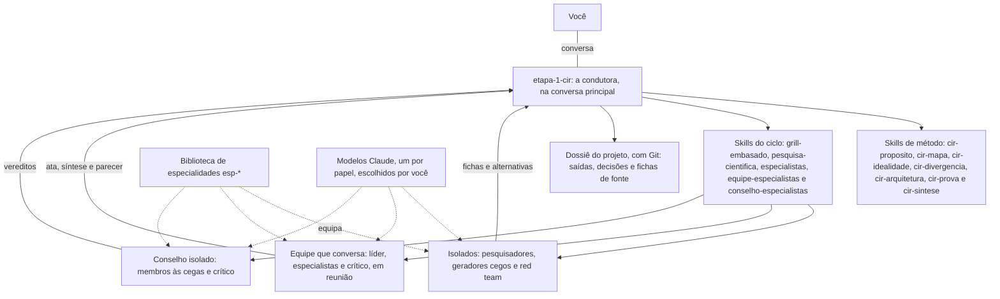

# Plano geral das skills — Etapa 1 (CIR)

<aside>
🧩

**O que é:** o plano geral das skills que executam o [Fluxograma completo — Etapa 1 (método IDEAL em ciclo)](Fluxograma%20completo%20%E2%80%94%20Etapa%201%20(m%C3%A9todo%20IDEAL%20em%20cic%20f1f71e3bd5e6487ebdfc94cd7e9fa161.md): que skills existem, o propósito de cada uma no fluxograma, que combinação de skills entra em cada sub-etapa, como elas trocam informação e em que ordem serão planejadas e construídas.

**Versão 2, com as suas alterações:** equipes de especialistas que conversam entre si para elaborar e verificar, ao lado do conselho que julga às cegas (seção 3); especialistas com especialidade de verdade, numa biblioteca curada (seção 4); reaproveitamento das skills que já existem (seção 8); e Claude primeiro em todos os papéis, no modelo que você escolher para cada um, com outras famílias só onde o teste mostrar necessidade (seção 10). A construção começa no Notion, e a mesma skill se adapta depois a cada ferramenta (seção 1).

**Substitui** o [Plano da skill — Etapa 1 (método IDEAL)](../Plano%20da%20skill%20%E2%80%94%20Etapa%201%20(m%C3%A9todo%20IDEAL)%20d9c7228935f8435a940a458f1fdec061.md), que previa uma skill só, no Codex. O próximo passo é planejar cada skill em detalhe, uma por vez (seção 15).

</aside>

## 1. Decisões que orientam o plano

| Decisão | Efeito no plano |
| --- | --- |
| Começar no Notion, no formato aberto, e adaptar a cada ferramenta | O mesmo conteúdo em todas: skills no padrão aberto; o que muda fica nas referências de cada ambiente e no adaptador; no Claude Code, hooks e subagentes num plugin; os mesmos testes em cada ambiente; peça específica de uma ferramenta, como um Custom Agent do Notion, só entra se as instruções forem exportáveis e o ganho compensar, pelo menos no Notion |
| Arquitetura modular | Uma condutora, cinco skills genéricas do ciclo, sete skills de método (uma por tema; o tema 4 tem duas) e uma biblioteca de especialidades |
| Três formações de agentes | Isolados para gerar alternativas e pesquisar; equipe que conversa para elaborar, verificar e integrar; conselho isolado para julgar (seção 3) |
| Especialistas de verdade | Cada especialista tem papel, especialidade e equipamento; a especialidade vem de uma skill curada e testada, nunca de uma persona criada na hora (seção 4) |
| Reusar antes de construir | Cada skill parte da melhor que já existe; escrevemos só a diferença, e o teste cego decide (seção 8) |
| Temas 1, 3, 5 e 6 com trava | A condutora não avança sem a sua aprovação nesses temas; nos outros, o que for pulado fica registrado |
| O modelo decide as perguntas | O `grill-embasado` define o objetivo e o padrão de qualidade das perguntas, não a quantidade nem o roteiro |
| Claude primeiro | Todos os papéis usam Claude na v1, com óticas, fontes e operadores diferentes; o modelo de cada papel é escolha sua, a cada projeto; outras famílias só onde o teste mostrar necessidade, na fase 10 (seção 10) |
| Critério máximo: a ideia melhor, mais criativa e eficaz | Na dúvida entre dois desenhos, vale o que mais contribui para a ideia; custo e tempo vêm depois |
| Sem limite de tempo ou custo | Doses altas por padrão; a eficiência vem da dose, da regra de parada e do reaproveitamento das fontes |
| Pesquisa sempre | A `pesquisa-cientifica` entra em toda sub-etapa que produz ou julga uma afirmação sobre o mundo |
| Grill sempre; conselho em toda validação e sob demanda | O `grill-embasado` abre cada tema e sub-etapa; o `conselho-especialistas` faz a triagem, as validações e as consultas no chat |
| Português e Git | Skills escritas em português; o dossiê de cada projeto fica numa pasta com Git, enviada a um repositório privado no GitHub |
| Teste com o Motor de Insights, com e sem o Anexo A | O Anexo A é o gabarito do teste de ponta a ponta |

## 2. Arquitetura



| Camada | Skills | Papel |
| --- | --- | --- |
| Condutora | `etapa-1-cir` | Fluxo dos temas, ciclo, dose, travas, dossiê e regras que valem o tempo todo. É a única que fala com você, e não opina sobre a ideia |
| Método | `cir-proposito`, `cir-mapa`, `cir-idealidade`, `cir-divergencia`, `cir-arquitetura`, `cir-prova`, `cir-sintese` | Como executar cada sub-etapa do tema: ferramentas do IDEAL, objetivo do grill, critérios de refutação, formatos de saída e exemplos |
| Ciclo | `grill-embasado`, `pesquisa-cientifica`, `especialistas`, `equipe-especialistas`, `conselho-especialistas` | Os passos do ciclo, iguais em qualquer tema. São genéricas e servem também às Etapas 2 e 3 |
| Especialidades | Biblioteca `esp-*` | O conhecimento de cada especialidade (métodos, critérios, erros típicos, ordens de grandeza e fontes de referência), carregado nos agentes que atuam por ela |
| Execução | Subagentes e adaptador de modelos | Os agentes das três formações |
| Infraestrutura | Scripts, hooks e modelos de documento | O que é mecânico e precisa sair sempre igual |
- **Skills de método separadas, e não um arquivo único.** Cada uma só entra no contexto quando o tema começa, pode ser chamada sozinha (ex.: só um pré-mortem), é testada isoladamente e pode ser pré-carregada nos subagentes que precisam dela. No Claude Code, a descrição de cada skill fica sempre visível, mas o conteúdo só carrega quando a skill é usada; num subagente com skills pré-carregadas, o conteúdo inteiro entra desde o início ([Claude Code: skills](https://code.claude.com/docs/en/skills)).
- **Só a condutora lê e grava o dossiê.** Os agentes recebem no brief só o que podem ver e devolvem tudo no formato combinado. Assim, nenhum deles tem acesso ao que não deveria ver (a sua versão, a autoria das hipóteses, os casos reservados), e a vigia de contaminação roda num lugar só. Nas reuniões, é a condutora que passa a palavra e grava a ata.
- **A condutora não opina.** Quem sintetiza uma reunião é o líder da equipe; quem julga é o conselho; quem decide é você.

## 3. Três formações: isolados, equipe e conselho

Cada trabalho do ciclo pede uma forma diferente de juntar agentes. A evidência, em pessoas e em modelos de IA, aponta para três.

| Formação | Para quê | Como trabalha | Por quê |
| --- | --- | --- | --- |
| **Isolados:** pesquisadores, geradores cegos, classificadores e red team | Gerar alternativas, buscar fontes e atacar | Cada um no seu contexto, sem ver a sua versão nem o trabalho dos outros | Pessoas que geram ideias separadas e depois juntam as listas produzem mais ideias, e melhores, do que grupos que geram conversando ([Diehl e Stroebe](https://doi.org/10.1037/0022-3514.53.3.497); [Mullen, Johnson e Salas](https://doi.org/10.1207/s15324834basp1201_1)) |
| **Equipe que conversa:** líder, 3 a 5 especialistas e o crítico | Elaborar a melhor versão, juntar especialidades, verificar o que exige mais de uma especialidade e integrar o tema | Reuniões estruturadas: cada um se prepara sozinho, depois fala em rodadas, discorda quando tem motivo, e o líder sintetiza | No Virtual Lab, um investigador principal de IA conduziu reuniões com agentes de especialidades diferentes e um crítico; a equipe montou um processo de projeto de nanocorpos e projetou 92, e os testes em laboratório acharam candidatos promissores ([Swanson et al., Nature](https://doi.org/10.1038/s41586-025-09442-9)). Sem estrutura, equipes de IA ficam abaixo do seu melhor membro, porque tendem a fazer média das opiniões ([Pappu et al.](https://arxiv.org/abs/2602.01011)) |
| **Conselho isolado:** 2 a 5 membros e o crítico | Julgar: triagem e validação | Cada membro julga sozinho e às cegas; uma troca de argumentos sem autoria, só se houver divergência; veredito por critério, sem média | O debate entre modelos rende pouco além do voto de opiniões independentes ([Choi, Zhu e Li](https://arxiv.org/abs/2508.17536)), e a influência social reduz a sabedoria das multidões ([Lorenz et al.](https://doi.org/10.1073/pnas.1008636108)). O que mais ajuda é misturar famílias de modelos ([Zhang et al.](https://arxiv.org/abs/2502.08788)); na v1, só com Claude, a independência vem do julgamento às cegas, e a mistura é testada na fase 10 |

**Regras da equipe** (a base da `equipe-especialistas`):

1. **Preparação individual antes da reunião.** Cada especialista escreve a sua contribuição sozinho, antes de ouvir os outros. Em grupo, o que todos já sabem domina a conversa, e o que só um sabe se perde ([Stasser e Titus](https://doi.org/10.1037/0022-3514.48.6.1467)).
2. **Pauta escrita:** a pergunta, o que decidir, o que entregar e as regras, como nas reuniões do Virtual Lab.
3. **Rodadas em ordem.** O líder abre; cada especialista fala na sua vez, discorda quando tem motivo e diz "passo" quando não tem nada novo; o crítico fala ao fim de cada rodada. De 2 a 3 rodadas.
4. **Autoridade por especialidade.** Numa questão da sua área, o especialista só é contrariado com contraprova verificável: fonte, cálculo ou contraexemplo. É a resposta ao principal achado de Pappu et al.: as equipes perdem porque não aproveitam o especialista que têm.
5. **Cálculo e código com ferramenta.** Contas, simulações e checagens rodam em Python, e o resultado entra na ata. Modelos acertam mais quando escrevem o programa do que quando calculam de cabeça ([Gao et al., PAL](https://arxiv.org/abs/2211.10435)).
6. **O líder sintetiza sem fazer média.** A síntese diz o que se decidiu, por quê, quem discordou e o que mudaria a decisão, e pode contrariar a maioria se a evidência pedir.
7. **Identidade dos modelos oculta.** Os membros se conhecem pela especialidade, não pelo modelo: modelos tendem a concordar mais com a maioria quando ela é da mesma família ([Soffer et al.](https://arxiv.org/abs/2609.33495)). Com só Claude na v1, todos são da mesma família: daí a rodada 1 independente e a troca de argumentos sem autoria.
8. **Tamanho.** De 3 a 5 especialistas e o crítico; quanto maior a equipe, mais ela faz média ([Pappu et al.](https://arxiv.org/abs/2602.01011)). Na dose completa, 2 ou 3 reuniões paralelas com a mesma pauta e uma reunião de fusão, como no Virtual Lab.
9. **Reuniões individuais.** Para uma tarefa focada (um cálculo, uma revisão de literatura da área), um especialista trabalha só com o crítico.

**Equipe de verificação.** Quando o "refuta se" de uma sub-etapa exige combinar especialidades (no teste do impossível, por exemplo, juntar matemática, física e computação para saber se um limite é de princípio), uma equipe que não elaborou a versão se reúne antes do veredito e entrega um parecer técnico, com cálculos e fontes. O conselho recebe o parecer como evidência, sem autoria, e julga sozinho. A conversa acontece antes do veredito; o veredito fica com quem não conversou.

**Transporte.** O protocolo fica na skill; o jeito de rodar fica no plano detalhado da `equipe-especialistas`, com duas opções para testar:

- **Reunião orquestrada (padrão).** Cada membro é um agente com nome: no Notion, uma sessão filha; no Claude Code, um subagente. A condutora passa a palavra pela ferramenta de mensagens, e cada um retoma com o próprio contexto (a preparação e o que ouviu). Isso funciona sem ativar as equipes de agentes ([Claude Code: subagentes](https://code.claude.com/docs/en/sub-agents)) e aceita membros de outras famílias pelo adaptador, que recebem a ata a cada rodada.
- **Equipes de agentes do Claude Code.** Os membros trocam mensagens diretamente e dividem uma lista de tarefas. Mas o recurso é experimental, só roda em sessão interativa, permite uma equipe por sessão, não retoma uma equipe interrompida e não pré-carrega skills pelo campo da definição do subagente ([Claude Code: equipes de agentes](https://code.claude.com/docs/en/agent-teams)).

**O que a evidência calibra:**

- A estrutura deve acompanhar a complexidade: um especialista sozinho para o simples, equipe para o complexo ([MDAgents](https://arxiv.org/abs/2404.15155)). É a lógica da dose.
- Personas variadas e mais profundidade aumentam a diversidade de ideias, e variedade no lado crítico aumenta a viabilidade ([Ueda et al.](https://arxiv.org/abs/2507.08350)).
- Sistemas multiagente falham sobretudo por tarefa mal especificada, desalinhamento entre agentes e verificação fraca ([Cemri et al.](https://arxiv.org/abs/2503.13657)). Daí a pauta escrita, o crítico e o formato de entrega.
- Multiagente gasta muito: no sistema de pesquisa da Anthropic, cerca de 15 vezes os tokens de uma conversa, e rende mais em tarefas amplas e paralelas do que nas que dependem de contexto compartilhado ([Anthropic](https://www.anthropic.com/engineering/multi-agent-research-system)).

**O que não está provado:** que a conversa da equipe supere os mesmos especialistas trabalhando isolados, com uma boa síntese. O Virtual Lab mostra que a equipe funciona, mas não compara as duas formas. Por isso, o teste da seção 13 compara a equipe com o melhor especialista sozinho e com os especialistas isolados, e a dose só usa a equipe onde ela vencer.

## 4. Especialistas

**Um especialista tem três partes:**

| Parte | O que é | Exemplo |
| --- | --- | --- |
| Papel | O que ele faz na formação | Membro da equipe de elaboração; membro do conselho com a ótica de refutador de limites teóricos; gerador cego |
| Especialidade | Uma skill `esp-*` com os métodos, critérios, erros típicos, ordens de grandeza e fontes de referência da área | `esp-estatistica`: desenho de estudo, poder estatístico e vieses de medição |
| Equipamento | Ferramentas e modelo | Busca e leitura na web, Python e bases de artigos; o modelo Claude que você escolher para o papel |

**Persona sozinha não basta.** Mandar o modelo "ser um especialista" não melhora a acurácia ([Zheng et al.](https://arxiv.org/abs/2311.10054); [Basil et al.](https://arxiv.org/abs/2512.05858)) e pode até piorá-la ([Hu, Rostami e Thomason](https://arxiv.org/abs/2603.18507)). O que melhora é conhecimento curado no contexto: no SkillsBench, skills escritas por pessoas elevaram a taxa de acerto de 33,9% para 50,5%, e as que o próprio agente gerou ficaram abaixo de não usar skill nenhuma ([SkillsBench](https://arxiv.org/abs/2602.12670)).

**As três opções que você levantou:**

| Opção | Ponto forte | Limite | Fica com |
| --- | --- | --- | --- |
| Uma skill que ensina a IA a criar os agentes na hora | Serve a qualquer problema e escolhe as especialidades certas para cada um | O conhecimento da especialidade sai do próprio modelo: é a persona e a skill autogerada, que não ajudam | O recrutamento: decidir que especialidades o problema pede, como o investigador principal do Virtual Lab escolhe a equipe |
| Uma skill por especialidade | É o tipo de conhecimento que comprovadamente ajuda; skills focadas rendem mais que pacotes exaustivos ([SkillsBench](https://arxiv.org/abs/2602.12670)) | Precisa ser escrita, revisada e testada; não dá para cobrir tudo de antemão | A biblioteca `esp-*`, que cresce conforme os projetos pedem |
| Procurar skill feita por especialista | Traz o método de quem é da área | Rara e de qualidade desigual | A primeira fonte de cada `esp-*`. Exemplos: a `scientific-problem-selection`, da Anthropic, baseada em Fischbach e Walsh ([Cell](https://doi.org/10.1016/j.cell.2024.03.012)) e num curso de Stanford; a `statistical-power`, da K-Dense; e a `math-olympiad`, da Anthropic, com verificação adversarial |

**O ideal é o híbrido:** a skill `especialistas` recruta e monta; a biblioteca `esp-*` dá a especialidade; e cada `esp-*` começa pela busca de uma skill ou método publicado por gente da área.

**Como uma especialidade entra na biblioteca:**

1. Procurar skill de especialista ou método publicado (livro-texto, diretriz, curso) e conferir licença e conteúdo.
2. Se não houver, escrever a skill a partir das fontes de referência da área, com a `pesquisa-cientifica`.
3. Revisão sua e, quando possível, de um especialista humano da área.
4. Teste com e sem a skill, em 5 a 10 problemas da área com resposta conhecida; ela só entra se melhorar. É o "treino" possível: não um modelo treinado, mas conhecimento conferido contra problemas reais.
5. Versão fixa e registro de origem.
- **Sem skill, roda marcado.** Se o problema pede uma especialidade que ainda não está na biblioteca, o agente atua com papel e equipamento, a ficha diz "sem skill de especialidade", e a lacuna vai para a fila. A especialidade nunca é gerada na hora.
- **Treinar um modelo por especialidade** (fine-tuning) exigiria API paga e dados de cada área, e não é necessário: o ganho medido vem do conhecimento curado no contexto.
- **Primeira leva:** sai do 2.7 do Motor de Insights e dos casos de teste. Para o Motor, as candidatas são ciência da decisão, estatística e inferência causal, computação e aprendizado de máquina, e filosofia da ciência; o 2.7 confirma.
- **Óticas não são especialidades.** A ótica (guardião, refutador, natureza humana, adversário, construtivo, explorador) diz o que procurar; a especialidade diz com que conhecimento. Um membro do conselho pode ter as duas: refutador de limites teóricos com a `esp-fisica`, por exemplo. As óticas ficam na `conselho-especialistas`; as especialidades, na biblioteca.

## 5. O ciclo em skills

| Passo do ciclo | Skill | Quem executa |
| --- | --- | --- |
| 1. Grill | `grill-embasado`, modo abertura, com o objetivo dado pela skill de método | Condutora |
| 2. Sua versão | `etapa-1-cir`, que registra a origem | Condutora |
| 3. Triagem | `conselho-especialistas`, conselho de triagem | Membros e crítico, isolados |
| 4. Pesquisa | `pesquisa-cientifica`, modo desenvolver | De 1 a 5 pesquisadores em paralelo, isolados |
| 5. Perguntas | `grill-embasado`, modo desafio, a partir das fichas de fonte | Condutora |
| 6. Checagem das respostas | `grill-embasado` e `pesquisa-cientifica`, modo conferir | Condutora e, se preciso, um pesquisador |
| 7. Elaboração e alternativas | `especialistas` monta a equipe e os geradores; `equipe-especialistas` conduz a reunião, com a skill de método do tema | Equipe em reunião; geradores cegos isolados |
| 8. Validação | `equipe-especialistas`, no modo verificação, quando o "refuta se" pede; `conselho-especialistas`, com a `pesquisa-cientifica` no modo refutar | Equipe de verificação; membros e crítico do conselho, isolados |
| 9. Decisão | `etapa-1-cir`, que aplica as travas | Você, com a condutora |
| 10. Registro | `etapa-1-cir`, com o registro de decisões e a vigia de contaminação | Condutora |

**No nível do tema,** a integração das saídas é uma reunião da equipe (`equipe-especialistas`, modo integração), e a validação integrada é do conselho completo.

## 6. Combinação de skills por sub-etapa

Em todas as sub-etapas, a condutora abre com o `grill-embasado` e fecha com o registro. As tabelas mostram o resto: a pesquisa (`pesquisa-cientifica`, com o foco e o número de pesquisadores), a equipe e as alternativas (`especialistas` e `equipe-especialistas`) e a validação (`conselho-especialistas` e, quando indicada, a equipe de verificação). Toda sub-etapa pesquisa, nem que seja para conferir o que entrou de novo; as exceções são a preparação, o teste de passagem e as decisões, que não produzem afirmação nova. Os conselhos e templates estão na seção 2.4 do fluxograma completo, e as equipes, na seção 2.5.

**Como ler "Equipe e alternativas":** "equipe" é a reunião de elaboração, no tamanho da dose (padrão: 3 especialistas e o crítico, em 2 rodadas; completa: de 3 a 5 e o crítico, em 2 ou 3 rodadas, com reuniões paralelas e fusão quando a saída é central). Geradores cegos, classificadores e red team trabalham sempre isolados. "Equipe de verificação" é outra equipe, que não elaborou, e entrega um parecer técnico antes do veredito.

### Tema 0 — método dentro da `etapa-1-cir`

| Sub-etapa | Dose | Pesquisa | Equipe e alternativas | Validação | Saída no dossiê |
| --- | --- | --- | --- | --- | --- |
| 0.1 Ficha do projeto | Padrão | Visão geral, 1 | — | Crítico | `00-ficha.md` |
| 0.2 Separação por etapa | Padrão | Conferir, 1 | 2 classificadores cegos | Rápido (guardião e refutador) | `00-separacao.md`, banco, fronteiras e estacionamento |
| 0.3 Preparação | Leve | — | — | — | `estado.json` e mapa de modelos |

### Tema 1 — `cir-proposito`

| Sub-etapa | Dose | Pesquisa | Equipe e alternativas | Validação | Saída no dossiê |
| --- | --- | --- | --- | --- | --- |
| 1.1 Escada do para quê | Completa | Desenvolver, 2 ou 3 | Equipe e 2 geradores cegos | Triagem e rápido Propósito | `01-proposito.md` |
| 1.2 Formulações | Completa | A favor e contra, 3 a 5 | Você, geradores cegos e equipe | Completo Propósito | `01-proposito.md` |
| 1.3 Job | Padrão | Observação do job, 2 | Equipe, com as variações do job, e 1 gerador cego | Rápido (natureza humana e refutador) | `01-proposito.md` |
| 1.4 Mapa de partes | Completa | Partes e incentivos, 3 | Geradores cegos por disciplina; a equipe junta os mapas | Rápido (adversário e guardião) | `01-proposito.md` |
| 1.5 Valores e linhas vermelhas | Completa | Danos e consequências, 2 ou 3 | Equipe e geradores cegos | Rápido (guardião e natureza humana) | `01-proposito.md` |
| 1.6 Estado ideal | Completa | Limites, 2 ou 3 | Você, geradores cegos e equipe | Triagem e rápido Propósito | `01-proposito.md` |
| 1.7 Congelamento | Integrada | Dentro do conselho | Integração em equipe e pacotes alternativos cegos | Completo Propósito · trava | `decisoes.md` |

### Tema 2 — `cir-mapa`

| Sub-etapa | Dose | Pesquisa | Equipe e alternativas | Validação | Saída no dossiê |
| --- | --- | --- | --- | --- | --- |
| 2.1 Job map | Padrão | Como o job é feito, 2 ou 3 | Equipe e 1 gerador cego | Rápido Evidência | `02-mapa.md` |
| 2.2 Falhas e causas | Completa | A favor e contra, separadas, 3 a 5 | Equipe e geradores de causas concorrentes | Equipe de verificação e completo Evidência | `02-mapa.md` |
| 2.3 Contradições | Completa | Refutar, 2 ou 3 | Listas independentes; a equipe escreve cada contradição como par de parâmetros | Triagem | `02-mapa.md` |
| 2.4 Projeção de referência | Padrão | Tendências, 1 ou 2 | — | Rápido (refutador e especialista do domínio) | `02-mapa.md` |
| 2.5 Espaço K | Completa | Desenvolver e conferir, 3 a 5 | — | Completo Evidência | `02-mapa.md` e `fontes/` |
| 2.6 Banco de casos | Completa | Casos documentados, 3 independentes | — | Rápido Evidência | `casos/` |
| 2.7 Especialistas e conselhos | Padrão | Disciplinas, 1 | Recrutamento pela `especialistas` e 1 gerador cego de disciplinas distantes | Rápido (explorador e construtivo) | `especialistas.md` |
| Validação integrada | — | Dentro do conselho | Integração em equipe | Completo Evidência | `decisoes.md` |

### Tema 3 — `cir-idealidade`

| Sub-etapa | Dose | Pesquisa | Equipe e alternativas | Validação | Saída no dossiê |
| --- | --- | --- | --- | --- | --- |
| 3.1 Resultados desejados | Completa | Como o campo mede sucesso, 2 ou 3 | Equipe e geradores cegos | Rápido Idealidade | `03-idealidade.md` |
| 3.2 Efetividade, custo de uso e dano | Completa | Custo cognitivo e dano, 2 ou 3 | Equipe | Rápido (natureza humana e guardião) | `03-idealidade.md` |
| 3.3 Linha de base e limite | Completa | Valores medidos, 2 ou 3 | — | Rápido Evidência | `03-idealidade.md` |
| 3.4 RFI | Completa | Analogias, 2 | Você e geradores cegos | Rápido Idealidade | `03-idealidade.md` |
| 3.5 Teste do impossível | Completa | Refutar, 3 a 5 | — | Equipe de verificação (matemática, física ou engenharia, e computação) e triagem reforçada, com dois refutadores de óticas diferentes | `03-idealidade.md` e `fronteiras.md` |
| 3.6 Métricas, critério e casos | Integrada | Dentro do conselho | Integração em equipe e conjuntos alternativos cegos | Completo Idealidade · trava | `casos/` e `decisoes.md` |

### Tema 4 — `cir-divergencia` (4.1 a 4.7) e `cir-arquitetura` (4.8 a 4.15)

| Sub-etapa | Dose | Pesquisa | Equipe e alternativas | Validação | Saída no dossiê |
| --- | --- | --- | --- | --- | --- |
| 4.1 Sua geração primeiro | Padrão | O que já existe, 1 ou 2 | — | Triagem, ideia a ideia | `banco.md` |
| 4.2 Desafios de geração | Padrão | Outros campos, 1 | — | Rápido (explorador e construtivo) | `04-desafios.md` |
| 4.3 Divergência no núcleo | Completa | Mecanismos e analogias, 3 a 5 | Geradores cegos, cada um com operadores diferentes, sempre isolados | Triagem, ideia a ideia | `banco.md` |
| 4.4 Tangentes | Padrão | Conferir, 1 | Geradores de tangentes, isolados | No 4.9 | `banco.md` |
| 4.5 Famílias e fichas | Completa | Princípios das famílias, 2 | — | Rápido Diversidade | `04-familias.md` |
| 4.6 Esboço integrado | Padrão | Conferir | Equipe | No 4.7 | `04-esboco.md` |
| 4.7 Conflitos e sinergias | Completa | Evidência dos conflitos, 2 | Equipe de verificação, diferente da do 4.6 | Rápido (adversário e natureza humana) | `04-esboco.md` |
| 4.8 Escada de abstração | Padrão | Conferir | Equipe | Rápido (construtivo e refutador) | `04-triagem.md` |
| 4.9 Classificação | Completa | Conferir, 1 ou 2 | Você primeiro | Elementos, elemento a elemento | `04-triagem.md` e `estacionamento.md` |
| 4.10 RFI na função | Padrão | Conferir, 1 | — | Rápido Idealidade | `04-triagem.md` |
| 4.11 Famílias que seguem | Completa | Dentro do conselho | — | Completo Arquitetura | `decisoes.md` |
| 4.12 De propósito a princípio | Padrão | Princípios de solução, 1 ou 2 | Equipe | Rápido Arquitetura | `04-arquitetura.md` |
| 4.13 Decomposição e capacidades | Completa | Sistemas análogos, 2 | Equipe | Rápido Arquitetura | `04-arquitetura.md` e `fronteiras.md` |
| 4.14 Cenários | Padrão | Conferir, 1 | Equipe e 1 gerador cego | Rápido (natureza humana e adversário) | `04-arquitetura.md` |
| 4.15 Núcleo invariante | Completa | Conferir, 1 | — | Rápido Arquitetura | `04-arquitetura.md` |
| Validação integrada | — | Dentro do conselho | Integração em equipe | Completo Arquitetura | `decisoes.md` |

### Tema 5 — `cir-prova`

| Sub-etapa | Dose | Pesquisa | Equipe e alternativas | Validação | Saída no dossiê |
| --- | --- | --- | --- | --- | --- |
| 5.1 Saídas ideais | Completa | O que se sabia na época, 2 ou 3 | A equipe escreve; um juiz cego avalia | Rápido Prova | `05-prova.md` |
| 5.2 Casos reservados | Completa | O que se sabia na época, 2 ou 3 | A equipe escreve; um juiz cego avalia | Rápido Prova | `05-prova.md` |
| 5.3 Pré-mortem | Completa | Falhas documentadas, 2 | Especialistas sozinhos; a equipe consolida | Rápido (natureza humana e adversário) | `05-prova.md` |
| 5.4 Red team | Completa | Refutar | Red team isolado, com óticas diferentes | O próprio ataque | `05-prova.md` |
| 5.5 Matriz conceitual | Completa | Refutar, dentro do conselho | — | Completo Prova | `05-prova.md` |
| 5.6 Avaliar antes de gerar mais | Padrão | Conferir | — | — | `decisoes.md` |
| 5.7 Conceito de referência | Integrada | — | Integração em equipe | O conjunto do tema · trava | `decisoes.md` |

### Tema 6 — `cir-sintese`

| Sub-etapa | Dose | Pesquisa | Equipe e alternativas | Validação | Saída no dossiê |
| --- | --- | --- | --- | --- | --- |
| 6.1 Redação do CIR | Padrão | Conferir | — | Crítico | `06-cir.md` |
| 6.2 Pacote da Etapa 2 | Completa | Conferir | — | Rápido Passagem | `06-pacote-etapa-2.md` |
| 6.3 Estacionamento da Etapa 3 | Leve | Conferir | — | Rápido (guardião e refutador) | `06-estacionamento-etapa-3.md` |
| 6.4 Teste de passagem | Completa | — | Leitor sem contexto, isolado | — | `06-cir.md` corrigido |
| 6.5 Critério de pronto | Completa | Conferência final das fontes | — | Crítico e scripts | `06-pronto.md` |
| 6.6 Aprovação e retrospectiva | — | — | — | Trava | `conselho/placar.md` |

## 7. As skills e o propósito de cada uma

### `etapa-1-cir` · condutora

- **Propósito no fluxograma:** levar a Etapa 1 da ideia ao CIR aprovado, garantindo que cada tema e sub-etapa passe pelo ciclo na dose certa, com as travas, o dossiê e as regras que valem o tempo todo.
- **Entra em:** tudo; é a skill que você chama.
- **Recebe:** a ideia, o propósito e o material que já existe; ou o dossiê, para retomar.
- **Entrega:** o dossiê atualizado, as perguntas e decisões para você e os briefs para as outras skills.
- **Contém:** temas e sub-etapas; o ciclo nos dois níveis; regras de dose; travas; o formato do registro de decisões; banco de ideias, fronteiras e estacionamento; vigia de contaminação; propósito congelado e reabertura; o tema 0, inclusive o modo auditoria; retomada entre sessões; conselho sob demanda; atalho com hipótese pronta; a formação de cada passo (isolados, equipe ou conselho); o commit no Git a cada registro.
- **Não faz:** opinar sobre a ideia, gerar alternativas ou julgar. Isso é das outras skills.
- **Risco principal:** virar um monólito que tenta fazer tudo e perde o fio entre sessões.
- **Como testar:** aderência ao fluxo, sub-etapa por sub-etapa; retomada no meio de um tema; pedidos fora do método (preço, MVP, pular trava, mudar o propósito).

### `grill-embasado` · genérica

- **Propósito no fluxograma:** fazer você pensar e revelar o que tem em mente, com perguntas embasadas e sem resposta recomendada, e checar as suas afirmações.
- **Entra em:** passos 1, 5 e 6 do ciclo, em todos os temas e sub-etapas.
- **Recebe:** o objetivo das perguntas, dado pela skill de método; o que já está no dossiê; as fichas de fonte.
- **Entrega:** perguntas com base, motivo e tipo; o registro das respostas; a checagem de cada afirmação.
- **Contém:** modo abertura e modo desafio; tipos de pergunta (esclarecimento, suposição, evidência, alternativa, consequência, "e se", contraexemplo e limite teórico); padrão de qualidade (uma ideia por pergunta, fonte conferida, nenhuma resposta sugerida, ordem pelo quanto a resposta muda a decisão); o que fazer quando uma resposta contradiz a evidência. Quantas perguntas, quais e como ficam a critério do modelo.
- **Risco principal:** perguntas genéricas, que induzem a resposta ou cansam.
- **Como testar:** julgamento cego da qualidade das perguntas; proporção de perguntas com fonte válida; detecção de perguntas que induzem a resposta.
- **Parte de:** `grilling` e `grill-me`, de Matt Pocock, e o `brainstorming` do superpowers (seção 8).

### `pesquisa-cientifica` · genérica

- **Propósito no fluxograma:** garantir que toda afirmação central venha de fonte aberta e conferida, na web e em artigos de ciência, matemática e engenharia.
- **Entra em:** passo 4 de toda sub-etapa; dentro da triagem e da validação, no modo refutar; na checagem das suas respostas.
- **Recebe:** o brief de pesquisa.
- **Entrega:** fichas de fonte, lacunas e o que foi procurado e não encontrado.
- **Contém:** modos desenvolver, refutar e conferir; ordem de força das fontes; abrir antes de citar, com o trecho que sustenta cada afirmação; conferência de DOI, arXiv e links por script; teoremas e leis viram restrições preservadas, e limites atuais, fronteiras técnicas; busca a favor e busca contra feitas por agentes separados.
- **Risco principal:** citação inventada ou decorativa e busca enviesada a favor da hipótese ([Generative Echo Chamber?](https://arxiv.org/abs/2402.05880)).
- **Como testar:** fontes inexistentes (alvo zero); auditoria de uma amostra de fichas: o trecho sustenta a afirmação?
- **Parte de:** os prompts de pesquisa multiagente da Anthropic e a `literature-review` da K-Dense (seção 8).

### `especialistas` · genérica

- **Propósito no fluxograma:** ter, em cada sub-etapa, os especialistas que o problema pede, e que sejam especialistas de verdade: papel, especialidade e equipamento (seção 4).
- **Entra em:** 2.7, que monta o mapa de especialidades do projeto; e os passos 3, 7 e 8 de cada sub-etapa, para montar o conselho, a equipe e os geradores daquela sub-etapa.
- **Recebe:** o problema da sub-etapa, o `especialistas.md` do projeto, a biblioteca `esp-*` e o mapa de modelos.
- **Entrega:** a ficha de cada agente (papel, especialidade, skill `esp-*` ou "sem skill", ferramentas, modelo, o que vê e o que não vê) e as lacunas da biblioteca.
- **Contém:** como recrutar (as especialidades que o problema exige, mais uma distante dele e o crítico); o tamanho por dose; os geradores cegos (brief e operadores diferentes em cada gerador); o caminho de uma especialidade até a biblioteca; a regra "sem skill, roda marcado".
- **Não faz:** gerar uma especialidade na hora nem inventar credenciais ("você é um PhD com 20 anos de experiência").
- **Risco principal:** especialistas que são o mesmo modelo com outro nome.
- **Como testar:** com e sem a `esp-*`, nos problemas da área; equipe recrutada contra equipe fixa; juiz cego de "as especialidades cobrem o problema?".
- **Parte de:** o recrutamento do Virtual Lab e do MDAgents (seção 8).

### `equipe-especialistas` · genérica

- **Propósito no fluxograma:** juntar especialidades diferentes numa síntese melhor do que a de qualquer uma sozinha, em reuniões estruturadas.
- **Entra em:** passo 7 das doses padrão e completa (elaboração); passo 8, quando o "refuta se" exige combinar especialidades (verificação); e o fim de cada tema (integração).
- **Recebe:** as fichas da `especialistas`; a pauta (a pergunta, o que decidir e o que entregar); a sua versão, sem autoria; as fichas de fonte; as restrições preservadas.
- **Entrega:** a ata, com o que cada um trouxe e onde discordaram, e por quê; a síntese do líder, com o que mudou e por quê, o dissenso e o que mudaria a decisão; na verificação, o parecer técnico, com cálculos e fontes.
- **Contém:** as regras da seção 3; reuniões paralelas e fusão; reuniões individuais; os três modos (elaboração, verificação e integração); o transporte.
- **Não faz:** julgar a versão final, que é do conselho, nem gerar as alternativas cegas.
- **Risco principal:** fazer média das opiniões e ficar abaixo do melhor especialista; conformismo.
- **Como testar:** síntese da equipe contra o melhor especialista sozinho e contra os especialistas isolados, em julgamento cego; sínteses que são média escondida; estabilidade entre execuções.
- **Parte de:** o protocolo de reuniões do Virtual Lab (seção 8).

### `conselho-especialistas` · genérica

- **Propósito no fluxograma:** validar qualquer coisa, antes ou depois de definida, com julgamento independente, às cegas e apoiado em pesquisa de refutação, preservando o dissenso.
- **Entra em:** passos 3 e 8 de toda sub-etapa, validações integradas e consultas sob demanda no chat.
- **Recebe:** o brief do conselho e, quando houver, o parecer da equipe de verificação, sem autoria.
- **Entrega:** matriz (+, 0, − ou ?) sem soma, vereditos com fonte, dissenso e o que mudaria cada veredito; placar atualizado.
- **Contém:** conselhos de triagem, rápido e completo; os templates de ótica; rodada 1 independente; uma troca de argumentos sem autoria, só se houver divergência, em que a posição só muda com evidência nova, como no método Delphi ([Rowe e Wright](https://doi.org/10.1016/S0169-2070%2899%2900018-7)); ordem sorteada; crítico numa sessão separada, sem saber a autoria; especialidade pela `especialistas` quando a ótica pede (o especialista do domínio, por exemplo); adaptador de modelos; placar.
- **Não faz:** conversar antes do veredito. O que pede conversa entre especialidades chega pelo parecer da equipe de verificação.
- **Risco principal:** conformismo, bajulação e modelos que pensam igual ([Artificial Hivemind](https://arxiv.org/abs/2510.22954)).
- **Como testar:** concordância com o gabarito do Anexo A; independência (rodada 1 sem sinais de cópia); estabilidade entre execuções; na fase 10, só Claude contra outras famílias.
- **Parte de:** o protocolo do llm-council e o transporte do claude-council (seção 8).

### `cir-proposito` · tema 1

- **Propósito no fluxograma:** chegar a um único propósito no nível do para quê, com job, partes, valores e estado ideal, e congelá-lo.
- **Entra em:** 1.1 a 1.7.
- **Contém:** escada do para quê e quando parar; formulações; job e teste de estabilidade; mapa de partes, com as indiretas; valores e linhas vermelhas; estado ideal ("destruído ontem à noite" e notícia do futuro); o objetivo do grill e o "refuta se" de cada sub-etapa; exemplos limpos e contaminados.
- **Entrega:** `01-proposito.md` e o registro do congelamento.
- **Risco principal:** propósito no nível do mecanismo, dois propósitos juntos ou palavras de produto.
- **Como testar:** no Motor de Insights, subir de "eliminar vieses" para "decidir bem"; casos com dois propósitos e com propósito sem "dor".
- **Parte de:** a `scientific-problem-selection`, da Anthropic, como complemento (seção 8).

### `cir-mapa` · tema 2

- **Propósito no fluxograma:** entender o fenômeno e por que o job falha, separar o que se sabe do que não se pode saber, juntar os casos antes de existir solução e definir os especialistas.
- **Entra em:** 2.1 a 2.7.
- **Contém:** job map; árvore de causas e causas concorrentes; contradições, separadas em de princípio e quebráveis; projeção de referência; espaço K; critérios do banco de casos (desfecho verificável, simetria, evidência contrária e "nada relevante") e a guarda dos reservados; o mapa de especialidades, equipes e conselhos do projeto, montado com a `especialistas`.
- **Entrega:** `02-mapa.md`, `casos/` e `especialistas.md`.
- **Risco principal:** virar pesquisa de mercado, causas sem evidência e casos escolhidos a dedo.
- **Como testar:** sem acesso ao Anexo A, quantos dos 18 pontos fracos e dos 20 modos de falha o mapa reencontra.
- **Parte de:** `synthesize-research` e `research-synthesis`, da Anthropic, quando houver dados de usuários (seção 8).

### `cir-idealidade` · tema 3

- **Propósito no fluxograma:** tornar o ideal extremo e mensurável e congelar o critério de refutação e os casos.
- **Entra em:** 3.1 a 3.6.
- **Contém:** resultados desejados; efetividade, custo de uso e dano; linha de base e limite; RFI do todo e por etapa; teste do impossível, com a tabela do v2 e uma lista inicial de limites de princípio comuns, para a pesquisa conferir; seleção de 5 a 12 métricas; critério de refutação; congelamento dos casos.
- **Entrega:** `03-idealidade.md` e `fronteiras.md`.
- **Risco principal:** promessa absoluta sem métrica, linha de base sem fonte e impossibilidade não detectada.
- **Como testar:** no Motor, detectar que "eliminar todo viés" é impossível em princípio e reformulá-lo.
- **Parte de:** a `scientific-problem-selection`, como complemento (seção 8).

### `cir-divergencia` · tema 4, passos 4 e 5

- **Propósito no fluxograma:** explorar o espaço de soluções de forma ampla e realmente diversa, com a sua geração primeiro, e expor conflitos e sinergias num esboço.
- **Entra em:** 4.1 a 4.7.
- **Contém:** desafios de geração; catálogo de operadores (C–K, TRIZ, Zwicky, SIT, Meadows, analogias por distância e função, inversão, 10× e provocações); divisão 70/30 e taxa de surpresa; de 20 a 30 ideias por rodada; formato do banco de ideias; fichas de família; juiz de diversidade; regra de parada; esboço e lista de conflitos.
- **Entrega:** `banco.md`, `04-desafios.md`, `04-familias.md` e `04-esboco.md`.
- **Risco principal:** ideias homogêneas e famílias que são variações umas das outras.
- **Como testar:** diversidade julgada às cegas; ideias que não aparecem nas condições sem skill; no Motor, as famílias do exemplo.
- **Reuso:** pode virar genérica nas Etapas 2 e 3 (alternativas técnicas, modelos de negócio).
- **Parte de:** `product-brainstorming`, `scientific-brainstorming` e `creative-thinking-for-research` (seção 8).

### `cir-arquitetura` · tema 4, passos 6 e 7

- **Propósito no fluxograma:** decidir o que entra no CIR pelo efeito no propósito e descrever como o conceito funciona, sem tecnologia nem telas.
- **Entra em:** 4.8 a 4.15.
- **Contém:** escada de abstração; cinco tipos e encaminhamento; RFI na função; taxa de surpresa; convergência por conjuntos; de propósito a princípio de solução; decomposição e independência; árvore de capacidades; cenários de operação; núcleo invariante e classes de capacidade; a regra do zigue-zague (quando a decomposição trava, a pergunta é da Etapa 2).
- **Entrega:** `04-triagem.md`, `04-arquitetura.md` e `estacionamento.md`.
- **Risco principal:** tela disfarçada de função e CIR que cresce por atração.
- **Como testar:** concordância com a sua classificação (80% ou mais); o exemplo do JEV.

### `cir-prova` · tema 5

- **Propósito no fluxograma:** escolher o conceito de referência com critérios que não são de mercado e testá-lo contra a realidade passada, sem retrospectiva e com casos reservados.
- **Entra em:** 5.1 a 5.7.
- **Contém:** saída ideal por caso, só com o que era observável na época; casos de simetria; casos reservados; pré-mortem; red team; matriz com os 10 critérios, sem soma; avaliar antes de gerar mais; convergência por conjuntos; regra de parada.
- **Entrega:** `05-prova.md` e o registro da escolha.
- **Risco principal:** casos julgados com retrospectiva, red team bajulador e soma escondida na matriz.
- **Como testar:** no Motor, os casos do Anexo A como gabarito.
- **Parte de:** `experimental-design`, `statistical-power`, `pre-mortem`, `red-team` e o verificador da `math-olympiad` (seção 8).

### `cir-sintese` · tema 6

- **Propósito no fluxograma:** consolidar o CIR, preparar a passagem para a Etapa 2 e o estacionamento da Etapa 3 e mostrar que está pronto.
- **Entra em:** 6.1 a 6.6.
- **Contém:** modelo do CIR, com as 17 seções e a origem de cada uma; pacote da Etapa 2; estacionamento; teste de passagem; critério de pronto, checado por script; vigia final; retrospectiva e placar.
- **Entrega:** `06-cir.md`, `06-pacote-etapa-2.md`, `06-estacionamento-etapa-3.md` e a retrospectiva.
- **Risco principal:** contaminação no CIR, dissenso perdido e pacote incompleto.
- **Como testar:** critério de pronto; perguntas do leitor sem contexto; vigia sem nenhum sinal.
- **Parte de:** o teste de leitor da `doc-coauthoring` (seção 8).

## 8. Skills existentes: o que reaproveitar

Nenhuma das skills encontradas tem eficácia medida de forma independente, e as próprias skills de trabalho de conhecimento da Anthropic se apresentam como pontos de partida genéricos, para personalizar ([knowledge-work-plugins](https://github.com/anthropics/knowledge-work-plugins)). A regra, então: partir da melhor que existe, escrever só a diferença e decidir por teste cego com o skill-creator, comparando a existente pura, a nossa e a combinação (seção 13).

**"Deep-research" não existe** no plugin de product management da Anthropic, que tem `competitive-brief`, `metrics-review`, `product-brainstorming`, `roadmap-update`, `sprint-planning`, `stakeholder-update`, `synthesize-research` e `write-spec`, nem nos outros repositórios oficiais. O mais próximo, e oficial, são os prompts do sistema de pesquisa multiagente da Anthropic, publicados no [claude-cookbooks](https://github.com/anthropics/claude-cookbooks/tree/main/patterns/agents/prompts) (MIT): um líder que planeja e divide a pesquisa, pesquisadores em paralelo e um agente que confere as citações. Eles viram a base da `pesquisa-cientifica`. Os plugins de pesquisa profunda do marketplace (Exa, Tavily e You.com) dependem de chave de API desses serviços.

| Nossa skill | Base existente | O que se aproveita | O que é nosso |
| --- | --- | --- | --- |
| `pesquisa-cientifica` | Prompts de pesquisa da Anthropic (claude-cookbooks, MIT); `literature-review` (K-Dense, MIT) | Líder que divide a pesquisa, pesquisadores em paralelo e agente de citações; protocolo de revisão de literatura | Fichas de fonte com o trecho; modos desenvolver, refutar e conferir; busca contra separada; verificador de DOI |
| `grill-embasado` | `grilling` e `grill-me` (Matt Pocock, MIT); `brainstorming` (superpowers, MIT) | Uma pergunta por vez nas de reflexão (até 3 juntas só nas rápidas de logística), até entender de verdade | Perguntas com fonte e sem resposta sugerida; checagem das respostas contra a evidência |
| `especialistas` | Recrutamento do [Virtual Lab](https://github.com/zou-group/virtual-lab) (MIT) e do [MDAgents](https://arxiv.org/abs/2404.15155) | O líder escolhe a equipe conforme o problema; a estrutura acompanha a complexidade | Fichas, biblioteca `esp-*` e as regras de modelo e de "sem skill" |
| `equipe-especialistas` | Reuniões do Virtual Lab (MIT) | Pauta, rodadas, crítico, reuniões paralelas com fusão e reuniões individuais | Preparação individual, autoridade por especialidade, cálculo com ferramenta, parecer técnico e identidade oculta |
| `conselho-especialistas` | [llm-council](https://github.com/karpathy/llm-council) (Karpathy, sem licença: só a ideia); [claude-council](https://github.com/hex/claude-council) (MIT) | Opiniões independentes, revisão anônima e síntese; chamadas em paralelo aos CLIs de várias empresas | Critérios com "refuta se", matriz sem soma, triagem, templates de ótica e placar |
| `cir-divergencia` | `product-brainstorming` (Anthropic, Apache 2.0); `scientific-brainstorming` (K-Dense, MIT); `creative-thinking-for-research` (Orchestra, MIT) | Técnicas de divergência e a sequência divergir, provocar e convergir | Operadores do IDEAL, divisão 70/30, juiz de diversidade e banco de ideias |
| `cir-mapa` | `synthesize-research` e `research-synthesis` (Anthropic, Apache 2.0) | Análise temática e triangulação, quando houver dados de usuários, sem a parte de roadmap | Job map, causas concorrentes, espaço K e banco de casos |
| `cir-prova` | `experimental-design` e `statistical-power` (K-Dense, MIT); `pre-mortem` e `red-team` (pm-skills, MIT); `math-olympiad` (Anthropic, Apache 2.0) | Checagens do desenho de teste e o verificador adversarial em contexto novo | Saídas sem retrospectiva, casos reservados e matriz de 10 critérios |
| `cir-sintese` | `doc-coauthoring` (Anthropic; licença a conferir) | O teste com leitor sem contexto | Modelo do CIR, pacote, estacionamento e critério de pronto |
| `cir-proposito` e `cir-idealidade` | `scientific-problem-selection` (Anthropic, Apache 2.0) | Bombas de intuição e árvore de decisão de Fischbach e Walsh, como complemento | Escada do para quê, RFI e teste do impossível |
| Construção de todas | `skill-creator` (Anthropic, Apache 2.0); `writing-skills` (superpowers, MIT) | Evals, comparação cega e ajuste das descrições | — |
| Fica para a Etapa 3 | `metrics-review` e `competitive-brief` (Anthropic) | Métricas de produto e análise competitiva | — |
- **Copiar, e não instalar e chamar.** As skills existentes são genéricas: não conhecem o dossiê, as travas nem os formatos; duas skills com descrições parecidas disputam o mesmo pedido; algumas puxam para viabilidade e negócio, o que contamina a Etapa 1; e uma atualização muda o comportamento sem aviso. Por isso, o trecho útil é copiado para dentro da nossa skill, com versão fixa, licença e atribuição. Apache 2.0 e MIT permitem; sem licença (llm-council) ou com licença não comercial (Dean Peters, CC BY-NC-SA), só a ideia.
- **Avaliadas e deixadas de fora:** `consciousness-council` (K-Dense), que é uma conversa só, com várias vozes, e que os próprios autores dizem não ter avaliado; e o PAL MCP, pela licença fora do padrão e por estar parado desde dezembro de 2025.

## 9. Subagentes

| Subagente | Faz | Pré-carrega | Ferramentas | Vê | Não vê |
| --- | --- | --- | --- | --- | --- |
| Pesquisador | Busca e confere fontes | `pesquisa-cientifica` | Busca e leitura na web | A pergunta, o modo e o critério de refutação | Quem propôs a hipótese |
| Líder da equipe | Abre a reunião, sintetiza sem fazer média e registra o dissenso | `equipe-especialistas` e a skill de método do tema | Busca e leitura na web | A pauta, a sua versão sem autoria e as fichas de fonte | A autoria e o modelo de cada membro |
| Especialista | Prepara-se sozinho e fala pela sua especialidade | `equipe-especialistas`, a skill de método do tema e a sua `esp-*` | Busca e leitura na web e Python | A pauta, a versão base sem autoria, as fichas de fonte e a ata | A autoria e o modelo dos outros |
| Gerador cego | Cria alternativas com princípios diferentes | A skill de método do tema e, se houver, a `esp-*` da sua disciplina | Busca e leitura na web | O desafio, as restrições e os próprios operadores | A sua versão, o banco de ideias e os outros geradores |
| Membro do conselho | Julga pela sua ótica, pesquisando para refutar | `conselho-especialistas`, `pesquisa-cientifica` e, quando a ótica pede, uma `esp-*` | Busca e leitura na web e Python | As hipóteses sem autoria, em ordem sorteada, os critérios e o parecer de verificação | A autoria, os outros membros na rodada 1 e a sua preferência |
| Crítico | Confere método, lógica, fontes e contaminação, no conselho e em cada rodada da equipe | `conselho-especialistas`, `equipe-especialistas` e `pesquisa-cientifica` | Busca e leitura na web e Python | O que o conselho ou a equipe viu | A autoria |
| Leitor sem contexto | Faz o teste de passagem | `cir-sintese` | Nenhuma | Só o CIR e o pacote | O dossiê e a conversa |
- **Nenhum subagente lê o dossiê.** O que ele pode ver chega no brief. No Notion, os agentes cegos abrem num computador novo, porque a sessão filha divide, por padrão, o computador e os arquivos da sessão de origem. No Claude Code, as ferramentas e as skills pré-carregadas de cada subagente ficam na definição dele ([Claude Code: subagentes](https://code.claude.com/docs/en/sub-agents)).
- **Membros de equipe têm nome.** A condutora retoma cada um pela ferramenta de mensagens, e ele mantém o próprio contexto entre as rodadas ([Claude Code: subagentes](https://code.claude.com/docs/en/sub-agents)).
- **A especialidade entra pela ficha.** Como ela muda a cada equipe, o especialista carrega a sua `esp-*` no começo, pela ferramenta de skills. O plano detalhado da `especialistas` decide se vale ter uma definição de subagente por especialidade.
- **Cada membro do conselho pesquisa por conta própria.** Subagentes podem chamar outros subagentes, até três níveis abaixo da conversa principal por padrão; isso fica como opção para pesquisas grandes.

## 10. Modelos e acesso

**Claude primeiro:** na v1, todos os papéis usam Claude. O modelo de cada papel é escolha sua, a cada projeto, no 0.3, pelo orçamento de tokens ou pela complexidade, e fica no mapa de modelos do `estado.json`. Outras famílias entram na fase 10, só no papel em que o teste às cegas mostrar ganho.

| Papel | Modelo | Por quê |
| --- | --- | --- |
| Condutora | O modelo Claude que você escolher para o projeto, com esforço alto | Conduz tudo e guarda o estado |
| Pesquisadores | Claude | A qualidade vem do método e da conferência das fontes |
| Líder e especialistas da equipe | Claude, com especialidades, óticas e fontes diferentes | Misturar famílias de modelos melhorou de forma consistente o debate entre agentes ([Zhang et al.](https://arxiv.org/abs/2502.08788)): a equipe entra nos testes da fase 10 |
| Geradores cegos | Claude, cada gerador com brief e operadores diferentes, numa sessão isolada | Modelos diferentes já dão respostas parecidas entre si; com o mesmo modelo, a semelhança é ainda maior ([Artificial Hivemind](https://arxiv.org/abs/2510.22954)). Pelo critério máximo, os geradores são o primeiro teste da fase 10 |
| Conselho e red team | Claude, com óticas e fontes diferentes, todos no mesmo nível de modelo | Juntar várias respostas do melhor modelo rendeu mais, na maioria dos testes, que misturar modelos diferentes, porque a mistura baixou a qualidade média ([Self-MoA](https://arxiv.org/abs/2502.00674)); um júri de famílias diferentes julgou melhor e com menos viés que um juiz grande sozinho ([PoLL](https://arxiv.org/abs/2404.18796)), o que a fase 10 testa |
| Crítico | Claude, numa sessão que não produziu o artefato e não sabe quem o produziu | Avaliadores de IA favorecem as próprias gerações ([Panickssery, Bowman e Feng](https://arxiv.org/abs/2404.13076)); o teste mede se a sessão separada e a autoria oculta bastam |
| Leitor sem contexto | Claude, numa sessão nova, sem o contexto da condutora | Pega o que a condutora deu como óbvio |

| Caminho | Como | Custo |
| --- | --- | --- |
| Notion, a casa | Pela assinatura do Notion AI: a condutora no chat e cada membro numa sessão filha, no modelo Claude escolhido para o papel. A sessão pode abrir sem o contexto de origem e num computador novo, o que serve ao julgamento às cegas, com auditoria (seção 16), e as sessões trocam mensagens entre si, o que serve às reuniões | Créditos do Notion: escolher o modelo gasta os 500 créditos Select do mês por membro (Business e Enterprise) e, depois, créditos comprados, a US$ 10 por 1.000 ([Notion: créditos](https://www.notion.com/help/manage-your-ai-credits)) |
| Claude Code, na adaptação | Pela sua assinatura, com subagentes no lugar das sessões filhas. A API de agentes do Notion, em beta, abre sessões com Custom Agents e só entra pela regra da seção 1 ([Notion: API de agentes](https://developers.notion.com/guides/notion-agent-apis/overview)) | O plano |
| Outras famílias, na fase 10 | No Notion, sessões filhas com outro modelo: neste workspace há modelos de sete famílias (OpenAI, Anthropic, Google, xAI, DeepSeek, Kimi e GLM). Fora dele, o Gemini CLI com a conta Google, `gemini -p`, com saída em JSON e busca do Google ([Gemini CLI](https://github.com/google-gemini/gemini-cli)), e o Codex CLI, `codex exec`, que exige a assinatura do ChatGPT ([OpenAI: modo não interativo](https://developers.openai.com/codex/noninteractive)) | Créditos do Notion; no Gemini CLI, 1.000 pedidos por dia na conta gratuita; no Codex, a assinatura do ChatGPT, que você não tem |
| API | Só quando não houver outro caminho | Por consumo |
- **Adaptador de modelos.** No Notion, a condutora abre uma sessão filha por membro, com o brief montado por script e sem reescrevê-lo; no Claude Code, um subagente. Nos dois casos, a resposta volta no formato combinado. O mapa de modelos, no `estado.json`, diz que modelo faz cada papel. Na fase 10, o mesmo adaptador manda o brief, ou a ata da reunião, a outra família; alternativas para avaliar então: o plugin oficial da OpenAI para o Claude Code ([codex-plugin-cc](https://github.com/openai/codex-plugin-cc)), que já faz revisão adversarial pelo Codex, e o [claude-council](https://github.com/hex/claude-council), que consulta vários CLIs em paralelo.
- **De onde vem a diversidade, só com Claude:** das especialidades, das óticas e das fontes de cada membro; da rodada 1 independente; dos operadores de cada gerador; e do juiz de diversidade, que mede as famílias de ideias. O registro marca "só Claude" em cada papel, para a comparação da fase 10.
- **Qualidade parecida no conselho.** Um modelo mais fraco baixa a média ([Self-MoA](https://arxiv.org/abs/2502.00674)): os membros do conselho usam o mesmo nível de modelo, e um modelo mais leve, para poupar, entra como gerador, não como juiz.
- **Para a escolha, um dado da Anthropic:** um líder Opus 4 com pesquisadores Sonnet 4 superou o Opus 4 sozinho em 90,2% na avaliação interna deles ([Anthropic](https://www.anthropic.com/engineering/multi-agent-research-system)). O teste de custo mede os créditos por papel e por projeto, e a linha de base mostra o consumo por dose.
- **A ordem da fase 10, pelo critério máximo:** primeiro os geradores, onde a evidência mais aponta perda com o mesmo modelo; depois o crítico, o conselho e a equipe. Outra família fica só no papel em que vencer às cegas.
- **Juntar por papel, não por etapa.** Uma ferramenta é a casa, hoje o Notion: nela ficam a condutora, a conversa com você e o dossiê. As outras entram como trabalhadoras, chamadas para um papel: o Claude Code, como sala limpa nos testes sem o Anexo A e como plano B, se a aderência sem hooks falhar; o GitHub, para guardar e versionar o dossiê; na fase 10, outra família onde o teste pedir. Dividir o projeto por etapa, cada uma numa ferramenta, multiplicaria as passagens de contexto e os testes; falhas de especificação e de desalinhamento entre agentes estão entre as mais comuns em sistemas multiagente ([Cemri et al.](https://arxiv.org/abs/2503.13657)).

## 11. Dossiê e formatos

```jsx
cir/<projeto>/             pasta com Git; um commit a cada registro de decisão, enviado ao repositório privado no GitHub
  estado.json              tema, sub-etapa, doses, travas, pendências e mapa de modelos
  00-ficha.md              00-separacao.md
  01-proposito.md
  02-mapa.md               especialistas.md (especialidades, equipes e conselhos)
  casos/trabalho.md        casos/reservados.md (fechado até o tema 5)
  03-idealidade.md
  04-desafios.md           04-familias.md         04-esboco.md
  04-triagem.md            04-arquitetura.md
  05-prova.md
  06-cir.md                06-pacote-etapa-2.md   06-estacionamento-etapa-3.md
  06-pronto.md
  banco.md                 banco de ideias, com a origem de cada uma
  fronteiras.md            fronteiras técnicas para a Etapa 2
  estacionamento.md        o que vai para a Etapa 3, com o motivo
  decisoes.md              registro de decisões
  fontes/                  uma ficha por fonte
  equipe/                  pautas, atas, sínteses e pareceres técnicos
  conselho/                briefs, vereditos, chaves de autoria e placar.md
  grill/                   perguntas, respostas e checagens de cada sub-etapa
```

| Formato | De → para | Campos principais |
| --- | --- | --- |
| Brief de pesquisa | Condutora ou membro → pesquisador | Pergunta, modo, especialidade, critério de refutação e limites |
| Ficha de fonte | Pesquisador → todos | Referência, link, trecho, o que mostra, força da evidência, data e se foi conferida por script |
| Pergunta | `grill-embasado` → você | Pergunta, base, por que importa e tipo |
| Item do banco de ideias | Todos → skills do tema 4 | Ideia, origem, tema, família, princípio e situação |
| Ficha do especialista | `especialistas` → condutora | Papel, especialidade, skill `esp-*` ou "sem skill", ferramentas, modelo, o que vê e o que não vê |
| Pauta da reunião | Condutora → equipe | Pergunta, o que decidir, o que entregar, versão base sem autoria, restrições, rodadas e regras |
| Ata e síntese | Equipe → condutora | Contribuição de cada um, discordâncias com motivo, síntese do líder, dissenso e o que mudaria a decisão |
| Parecer técnico | Equipe de verificação → conselho | Afirmação verificada, cálculos ou código, fontes, conclusão e incerteza |
| Brief dos geradores | Condutora → geradores cegos | Desafio, restrições, operadores e formato de entrega |
| Brief do conselho | Condutora → membros | Hipóteses sem autoria, critérios, critério de refutação, ótica, parecer de verificação e o que entregar |
| Veredito | Membro → condutora | Critério a critério (+, 0, − ou ?), fonte e o que mudaria o veredito |
| Registro de decisão | Condutora → dossiê | Contexto, opções, escolha, evidência, dissenso, confiança e o que reverteria |

O [Plano detalhado — etapa-1-cir (condutora)](Plano%20geral%20das%20skills%20%E2%80%94%20Etapa%201%20(CIR)/Plano%20detalhado%20%E2%80%94%20etapa-1-cir%20(condutora)%20fccda0c36a5d403582b433a6f2b0657f.md) completa esta estrutura com `briefs/`, o índice do projeto (`AGENTS.md` e `CLAUDE.md`), o relatório de auditoria e a trava de sessão, e detalha os formatos que circulam entre as skills.

## 12. Infraestrutura e empacotamento

| Peça | Faz | Skill |
| --- | --- | --- |
| Vigia de contaminação | Procura sinais de Etapa 2 e 3 fora das fronteiras e do estacionamento a cada gravação no dossiê | `etapa-1-cir`, pelo script de registro; no Claude Code, também como hook |
| Verificador de fontes | Confere DOI, arXiv e links e marca a ficha | `pesquisa-cientifica` |
| Anonimizador e sorteio | Troca a autoria por H1, H2… e sorteia a ordem para cada membro; esconde o modelo de cada membro da equipe; a chave fica fora dos briefs | `conselho-especialistas` e `equipe-especialistas` |
| Adaptador de modelos | Envia o brief ou a ata à sessão com o modelo do papel (no Notion, por sessão filha; no Claude Code, por subagente; na fase 10, também ao CLI de outra empresa) e devolve a resposta no mesmo formato | Compartilhado, com uma referência por ambiente |
| Critério de pronto | Checa os 14 itens e as pendências | `cir-sintese` |
| Modelos de documento | CIR, ficha de fonte, ficha do especialista, pauta, ata, parecer, veredito, registro de decisão e ficha de família | Cada skill, na sua pasta |
| Trechos de skills existentes | O que foi aproveitado de outras skills, com versão fixa, licença e atribuição | Cada skill, em `references/` |
- **No Notion, primeiro:** as skills viram páginas do banco de Skills, com as referências em subpáginas e os scripts e modelos em Files, rodados no computador do agente. Sem hooks, a vigia roda pelo script de registro, e a aderência é medida nos testes, desde a fase 3.
- **Hooks, no Claude Code:** uma skill pode registrar hooks que continuam ativos pelo resto da sessão ([Claude Code: skills](https://code.claude.com/docs/en/skills)). A condutora usa isso para rodar a vigia de contaminação sempre que algo é gravado no dossiê.
- **Plugin, na adaptação ao Claude Code:** as 13 skills, a biblioteca `esp-*`, os subagentes, os hooks e o adaptador vão num plugin, que instala tudo de uma vez ([Claude Code: plugins](https://code.claude.com/docs/en/plugins)). Um detalhe para o plano da condutora: subagentes de plugin ignoram hooks, servidores MCP e modo de permissão próprios, então essas peças ficam no nível do plugin.

## 13. Testes

- **Condições:** A, sem skills; B, com o fluxograma completo e o v2 colados no prompt; C, com as skills. Pelo menos 3 execuções de cada, porque o resultado varia. A condição B mostra se as skills acrescentam algo além do conteúdo.
- **Caso principal:** o Motor de Insights, com e sem acesso ao Anexo A. Sem acesso, as skills devem reencontrar a maior parte dos 18 pontos fracos e dos 20 modos de falha e trazer perguntas e alternativas que o Anexo A não tem. No Notion, o Anexo A está no workspace, ao alcance dos agentes: o caso sem acesso vai com outro nome, os briefs proíbem a busca, e a auditoria dos eventos invalida qualquer execução que tenha buscado ou lido o documento do Motor; se isso não bastar, ele roda no Claude Code, que não enxerga o seu workspace.
- **Outros casos:** manter um hábito de exercício; água tratada chegando sem perdas a uma cidade; tornar um reencontro de amigos inesquecível; informar eleitores sobre candidatos; auditoria do documento do Motor de Insights v1.
- **Robustez:** pedir preço, tecnologia ou MVP; mudar o propósito no meio; pedir dados inventados; dar uma ideia só; pedir para pular uma trava; trazer dois propósitos.
- **Por skill e por sub-etapa:** evals do skill-creator, com dossiês prontos até a sub-etapa anterior.
- **Comparações que decidem o desenho,** todas em julgamento cego:
    - **Reuso:** a skill existente pura, a nossa e a combinação, nos mesmos casos. Fica a que vencer; no empate, a mais simples.
    - **Equipe:** a síntese da equipe, o melhor especialista sozinho e os mesmos especialistas isolados com a síntese do líder. Onde a equipe não vencer, a dose usa especialistas isolados.
    - **Especialidade:** com e sem a `esp-*`, nos problemas de teste da área.
    - **Transporte:** reunião orquestrada e equipes de agentes, em qualidade, custo e estabilidade.
    - **Outras famílias, na fase 10:** só Claude contra outra família, papel a papel, a começar pelos geradores; a outra família fica só onde vencer.

| Métrica | Como medir | Alvo |
| --- | --- | --- |
| Aderência | Asserções por sub-etapa | 90% ou mais |
| Contaminação | Vigia e revisão do CIR final | Nenhum sinal no CIR |
| Fabricação | Fontes, casos e números sem lastro apresentados como fato | Zero |
| Recuperação do gabarito | Pontos fracos e modos de falha do Anexo A reencontrados sem acesso a ele | A maior parte; o número sai da linha de base |
| Diversidade | Famílias com princípio diferente, julgadas às cegas | 3 ou mais, e mais variedade que em A e B |
| Triagem | Concordância com a sua classificação nos cinco tipos | 80% ou mais |
| Qualidade | Comparação cega de C com A e com B, feita por você e por um avaliador Claude numa sessão que não participou do projeto | C vence A em 70% ou mais e vence B |
| Independência do conselho | Vazamento de autoria e vereditos da rodada 1 parecidos demais | Nenhum vazamento |
| Passagem | Perguntas centrais do leitor sem contexto | Caem a cada versão |
| Custo e tempo | Tokens, tempo e turnos | Registrar, sem limite |
| Acionamento | Pedidos que devem e que não devem acionar cada skill | 80% ou mais de acerto e no máximo 10% de falso positivo |
| Ganho da equipe | Comparação cega da síntese com o melhor especialista sozinho e com os especialistas isolados | A equipe vence os dois onde for usada |
| Média escondida | Sínteses que só fazem média das posições, julgadas às cegas | Nenhuma |
| Ganho da especialidade | Acertos com e sem a `esp-*`, nos problemas da área | Melhora; senão, a skill não entra |

## 14. Roadmap

| Fase | Entrega | Pronto quando |
| --- | --- | --- |
| 0. Plano geral | Esta página | Você aprova |
| 1. Planos detalhados | Um plano por skill, na ordem da seção 15 | Você aprova cada um |
| 2. Linha de base | O Motor de Insights nas condições A e B, com as falhas anotadas por sub-etapa; e as skills de base da seção 8 rodando sozinhas | As falhas típicas estão registradas |
| 3. Núcleo | `etapa-1-cir` (esqueleto), as 5 genéricas, os subagentes, o adaptador do Notion (sessões filhas), os scripts, o repositório do dossiê no GitHub, com o acesso configurado uma vez, e a primeira leva de `esp-*` | Um ciclo completo roda numa sub-etapa de teste, no Notion, com equipe e conselho |
| 4. Temas 0 e 1 | `cir-proposito` | O Motor chega a um propósito congelado no nível do "decidir bem" |
| 5. Temas 2 e 3 | `cir-mapa` e `cir-idealidade` | O teste do impossível pega "eliminar todo viés" |
| 6. Tema 4 | `cir-divergencia` e `cir-arquitetura` | 3 ou mais famílias; o JEV classificado como no v2 |
| 7. Temas 5 e 6 | `cir-prova` e `cir-sintese` | O CIR do Motor passa no critério de pronto |
| 8. Ponta a ponta | O Motor com e sem o Anexo A e os outros casos, nas condições A, B e C, no Notion; o caso sem o Anexo A, em sala limpa (seção 13) | Alvos da seção 13 |
| 9. Publicação e descrições | As skills no banco de Skills do Notion e num pacote no formato aberto; ajuste das descrições para o acionamento | Acionamento no alvo |
| 10. Adaptação e depois | O Claude Code, com o plugin (hooks, subagentes e adaptador), e outras ferramentas, com os mesmos testes; os testes com outras famílias de modelos, papel a papel, a começar pelos geradores (seção 10); depois, o modo autônomo (caso de uso 2) | Os alvos da seção 13 em cada ambiente; outra família só no papel em que vencer às cegas; o modo autônomo, quando você decidir |

## 15. Ordem do planejamento detalhado

Uma skill por vez, sempre a partir do propósito dela no fluxograma:

1. **`etapa-1-cir`:** define o dossiê, os formatos e os contratos que as outras seguem. Plano pronto: [Plano detalhado — etapa-1-cir (condutora)](Plano%20geral%20das%20skills%20%E2%80%94%20Etapa%201%20(CIR)/Plano%20detalhado%20%E2%80%94%20etapa-1-cir%20(condutora)%20fccda0c36a5d403582b433a6f2b0657f.md).
2. **`conselho-especialistas`:** aparece em todas as validações; inclui o adaptador e o mapa de modelos. Plano pronto: [Plano detalhado — conselho-especialistas](Plano%20geral%20das%20skills%20%E2%80%94%20Etapa%201%20(CIR)/Plano%20detalhado%20%E2%80%94%20conselho-especialistas%20f31c25a61c914fd98fe1f1ad81c09ed4.md).
3. **`pesquisa-cientifica`:** tudo depende de fontes conferidas. Plano pronto: [Plano detalhado — pesquisa-cientifica](Plano%20geral%20das%20skills%20%E2%80%94%20Etapa%201%20(CIR)/Plano%20detalhado%20%E2%80%94%20pesquisa-cientifica%20b0dde96c53b34b38aa26c8c474ce1071.md).
4. **`grill-embasado`:** abre todas as sub-etapas. Plano pronto: [Plano detalhado — grill-embasado](Plano%20geral%20das%20skills%20%E2%80%94%20Etapa%201%20(CIR)/Plano%20detalhado%20%E2%80%94%20grill-embasado%20ec54d7f985534c0a997926c075d97775.md).
5. **`especialistas`:** recrutamento, fichas, o modelo de uma `esp-*` e a primeira leva.
6. **`equipe-especialistas`:** o protocolo das reuniões e o teste de transporte.
7. **`cir-proposito`, `cir-mapa`, `cir-idealidade`, `cir-divergencia`, `cir-arquitetura`, `cir-prova` e `cir-sintese`,** na ordem dos temas, para que cada uma possa ser testada com o dossiê da anterior.

**Cada plano detalhado terá:** propósito no fluxograma; as skills de base e o que se aproveita delas; quando a skill é acionada (a descrição); contrato de entrada e saída; passos; regras; formatos e modelos de documento; arquivos (`SKILL.md`, referências e scripts); subagentes; casos-limite; testes e métricas; riscos; o que fica de fora.

## 16. Riscos

| Risco | Mitigação |
| --- | --- |
| Orquestração complexa demais, com 13 skills e três formações | A condutora chama as skills pelo nome em cada sub-etapa; testes por sub-etapa; o plugin instala tudo junto |
| Você cansar de tantas perguntas e travas | O modelo dosa as perguntas; aprovação em lote nas doses leves; travas só em 4 temas |
| Vazamento entre agentes (a sua versão, a autoria, os casos reservados) | Só a condutora lê o dossiê; briefs e pautas com o mínimo necessário; agentes cegos sem leitura de arquivos, num computador novo e auditados; se vazar, a execução é refeita, e os testes sem o Anexo A passam ao Claude Code |
| Equipe que faz média e fica abaixo do melhor especialista | Autoridade por especialidade, líder que não faz média, equipes pequenas e o teste da seção 13; onde a equipe perder, a dose usa especialistas isolados |
| Conformismo na equipe | Preparação individual antes, crítico em cada rodada, identidade dos modelos oculta e veredito com o conselho, que não conversou |
| Especialidade fraca ou errada na biblioteca | Base em skill ou método publicado, revisão, teste com e sem e versão fixa |
| Skill de base que muda ou tem licença restritiva | Cópia com versão fixa e atribuição; licença não comercial ou ausente, só a ideia |
| Créditos do Notion acabando | O modelo de cada papel é escolha sua, com o custo medido na linha de base e o consumo por papel no `estado.json`; um modelo mais leve vira gerador, não juiz |
| Só Claude: erros e ideias parecidos entre os papéis | Especialidades, óticas, fontes e operadores diferentes; rodada 1 independente; juiz de diversidade; outras famílias na fase 10, onde o teste mostrar necessidade, a começar pelos geradores |
| Contexto da condutora estourar em projetos longos | Estado e saídas no dossiê; cada tema começa lendo só o que precisa |
| Fontes inventadas | Conferência por script e fichas com o trecho |
| Contaminação por mercado e tecnologia | Vigia a cada gravação, testes de robustez, exemplos limpos e contaminados, e skills de base copiadas sem as partes de roadmap, preço e métricas de negócio |
| Números da simulação do v2 tomados como fatos | Tratá-los como heurística e ajustá-los com os dados dos testes |
| Diferenças entre o Notion e as outras ferramentas | Um conteúdo só, no padrão aberto; o que muda fica nas referências de cada ambiente; os mesmos testes em cada ambiente (fases 8 e 10) |
| A aderência no Notion, sem hooks | Vigia pelo script de registro e de novo no fechamento do tema; aderência medida nos testes, desde a fase 3; se ficar abaixo do alvo, a casa passa ao Claude Code, com o Notion como fornecedor de modelos |
| O computador do agente não guardar o dossiê entre sessões | Repositório privado no GitHub, com envio a cada registro e atualização no início de cada sessão; teste de retomada numa sessão nova |

## 17. Decidido e em aberto

**Decidido:**

- Critério máximo: na dúvida entre dois desenhos, vale o que mais contribui para uma ideia melhor, mais criativa e eficaz; custo e tempo vêm depois.
- Skills em português.
- Dossiê numa pasta por projeto, com Git, enviada a um repositório privado no GitHub.
- Assinaturas: Claude e Notion AI. Claude primeiro em todos os papéis, no modelo que você escolher para cada um, a cada projeto; outras famílias só na fase 10, onde o teste mostrar necessidade; API paga, só em último caso.
- Notion primeiro: a casa é o Notion, com a condutora no modelo Claude que você escolher; as ferramentas se juntam por papel, não por etapa (seção 10); a adaptação ao Claude Code e a outras ferramentas vem depois, com os mesmos testes (fase 10).
- Universalidade primeiro: peça específica de uma ferramenta, como um Custom Agent do Notion, só entra se as instruções forem exportáveis e o ganho compensar, pelo menos no Notion; os agentes cegos usam sessões filhas incógnitas, num computador novo e com auditoria (seção 1).
- Aprovação: um "sim" a uma pergunta de sim ou não; toda outra decisão traz o motivo e o objetivo, nas suas palavras (seção 6.6 do plano da condutora).
- Três formações, especialistas com especialidade curada e reuso das skills existentes, com teste cego (esta versão).

**Em aberto:**

- **Especialista humano:** se há alguém que possa revisar alguma `esp-*`. Entra no plano da `especialistas`.
- **Transporte das reuniões:** reunião orquestrada ou equipes de agentes; o teste decide. Entra no plano da `equipe-especialistas`.

[Plano detalhado — etapa-1-cir (condutora)](Plano%20geral%20das%20skills%20%E2%80%94%20Etapa%201%20(CIR)/Plano%20detalhado%20%E2%80%94%20etapa-1-cir%20(condutora)%20fccda0c36a5d403582b433a6f2b0657f.md)

[Plano detalhado — conselho-especialistas](Plano%20geral%20das%20skills%20%E2%80%94%20Etapa%201%20(CIR)/Plano%20detalhado%20%E2%80%94%20conselho-especialistas%20f31c25a61c914fd98fe1f1ad81c09ed4.md)

[Plano detalhado — pesquisa-cientifica](Plano%20geral%20das%20skills%20%E2%80%94%20Etapa%201%20(CIR)/Plano%20detalhado%20%E2%80%94%20pesquisa-cientifica%20b0dde96c53b34b38aa26c8c474ce1071.md)

[Plano detalhado — grill-embasado](Plano%20geral%20das%20skills%20%E2%80%94%20Etapa%201%20(CIR)/Plano%20detalhado%20%E2%80%94%20grill-embasado%20ec54d7f985534c0a997926c075d97775.md)

[Plano detalhado — especialistas](Plano%20geral%20das%20skills%20%E2%80%94%20Etapa%201%20(CIR)/Plano%20detalhado%20%E2%80%94%20especialistas%2079544cfde9c5403babc8e5cc62fe12cd.md)