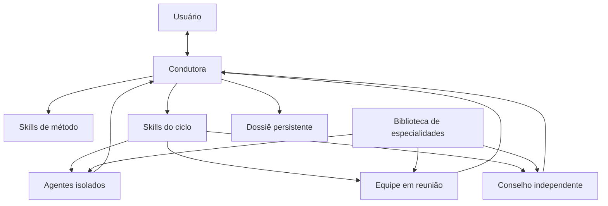

# Arquitetura das skills

Estado: desenho do sistema; condutora e conselho têm alphas documentados, incompletos neste checkout. [Grill](implementacao-grill.md), [especialistas](implementacao-especialistas.md) e [equipe](implementacao-equipe.md) têm protocolo e apoio local; outras 8 skills seguem planejadas. Revisão: 2026-10-23. Veja os escopos da [condutora](implementacao-condutora.md) e do [conselho](implementacao-conselho.md).

A Etapa 1 é organizada como um sistema de skills que transforma uma ideia em um CIR aprovado. A condutora coordena a conversa e o estado; as skills de método definem o trabalho de cada tema; as genéricas pesquisam, perguntam, elaboram e julgam. A separação permite carregar apenas o contexto da tarefa atual e testar componentes isoladamente. O plano geral especifica esse desenho; ele não comprova que o sistema já esteja instalado ou executável. Fonte: [S02, §§1–2 e 14](../sources/originais/plano-geral-skills-cir.md).

## As 13 skills propostas

| Camada | Skill | Responsabilidade |
| --- | --- | --- |
| Condutora | `etapa-1-cir` | Fluxo, doses, travas, conversa com o usuário, dossiê e retomada. |
| Ciclo | `grill-embasado` | Perguntas embasadas, registro das respostas e checagem das afirmações. |
| Ciclo | `pesquisa-cientifica` | Pesquisa nos modos desenvolver, refutar e conferir; fichas de fonte e lacunas. |
| Ciclo | `especialistas` | Recrutamento, composição das formações e identificação de especialidades ausentes. |
| Ciclo | `equipe-especialistas` | Reuniões de elaboração, verificação e integração; ata e síntese. |
| Ciclo | `conselho-especialistas` | Triagem e julgamento independente por critério; preservação do dissenso. |
| Método | `cir-proposito` | Propósito, job, partes, valores e estado ideal. |
| Método | `cir-mapa` | Fenômeno, causas, contradições, conhecimento disponível e casos. |
| Método | `cir-idealidade` | Resultados, métricas, RFI, limites e critérios de refutação. |
| Método | `cir-divergencia` | Alternativas, famílias de princípios, esboço e conflitos. |
| Método | `cir-arquitetura` | Triagem dos elementos, funções, capacidades e núcleo invariante. |
| Método | `cir-prova` | Casos, pré-mortem, red team e prova conceitual. |
| Método | `cir-sintese` | CIR, passagem à Etapa 2, estacionamento e critério de pronto. |

O tema 0 pertence à condutora. O tema 4 divide-se entre divergência e arquitetura. As sete skills de método cobrem os temas 1–6; as cinco genéricas atravessam o ciclo. Fonte: [S02, §§5–7](../sources/originais/plano-geral-skills-cir.md). Veja a sequência em [Fluxo da Etapa 1](fluxo-etapa1.md) e os conceitos em [Método IDEAL](metodo-ideal.md).

## Formações e fronteiras

As formações respondem a trabalhos diferentes:

- **Isolados:** pesquisam, geram alternativas ou atacam hipóteses sem receber o trabalho dos outros. Geradores cegos também não recebem a versão do usuário.
- **Equipe:** prepara contribuições individualmente, conversa em rodadas e integra especialidades. O líder sintetiza; o crítico examina o trabalho. Uma equipe de verificação deve ser diferente daquela que elaborou a versão.
- **Conselho:** julga sozinho na primeira rodada. Recebe critérios prévios e hipóteses sem autoria; uma troca posterior depende de divergência relevante. A decisão final pertence ao usuário.

A condutora não elabora nem julga a ideia. Só ela lê e grava o dossiê; os demais recebem briefs filtrados e devolvem resultados. O conselho alpha devolve um pacote externo para ela persistir. Isolamento exige verificação e auditoria, sobretudo quando agentes compartilham arquivos ou permissões. Fontes: [S02, §§2–3 e 9](../sources/originais/plano-geral-skills-cir.md), [S10, §§4 e 7](../sources/originais/plano-etapa-1-cir-condutora.md) e [S11, §4](../sources/originais/plano-conselho-especialistas-revisado.md).

No grill, quem pergunta é a própria condutora. O leitor recebe somente cartão e Entendimento, e a pesquisa recebe afirmações factuais sem autoria. Os scripts locais são ferramentas da condutora: não autenticam papéis, abrem sessões ou restringem permissões. Fonte: [S12, §§4, 9 e 12](../sources/originais/plano-grill-embasado.md).

[S14, §§5–7](../sources/originais/plano-equipe-especialistas.md) concretiza a equipe: preparação individual compartilhada por inteiro antes das falas, ordem sorteada, crítico por último, posições finais independentes e destino de cada contribuição. O alpha local ordena eventos e filtra tarefas, sem abrir sessões Claude ou provar isolamento. Elaboração completa central prevê duas/três paralelas; a fusão recebe apenas sínteses A/B/C, com líder novo e proveniência. Sem evidência discriminante, incompatíveis continuam como opções/dissenso.

## Especialidades e execução

Um especialista combina **papel, especialidade e equipamento**. A ótica define o que procurar; uma skill `esp-*` fornece métodos e conhecimento curado; ferramentas e modelo permitem executar a tarefa. A biblioteca deve crescer com fontes, procedência, revisão e comparação com/sem a especialidade. Sem uma `esp-*` disponível, o plano permite rodar com a lacuna explícita, sem inventar credenciais ou gerar a especialidade no momento. Fonte: [S02, §4](../sources/originais/plano-geral-skills-cir.md).

[S13, §§5–9](../sources/originais/plano-especialistas.md) concretiza o recrutamento pelo problema antes do catálogo, uma distante por elaboração, crítico, fichas com visibilidade copiada do papel e blocos fixados no Git. O alpha local verifica esses contratos e a regra numérica de admissão; nenhuma especialidade de produção foi curada. A biblioteca e o banco fechado de testes são repositórios separados; só a condutora grava mapas/fichas no dossiê.

O adaptador transporta briefs e resultados entre ambientes, registra modelo efetivo, situação, tempo e custo. O conteúdo do método permanece separado da forma de abrir sessões ou subagentes. O plano prioriza Notion; a integração real segue pendente. O conselho inclui transporte CLI local para a primeira rodada, sem sandbox de permissões. O usuário selecionou S11, que revisa S04: v1 Claude-first, com o mesmo juiz escolhido em sessões independentes e óticas distintas; diversidade de famílias fica para depois. Disponibilidade, isolamento e nomes atuais precisam ser verificados. Fontes: [S02, §§10 e 12](../sources/originais/plano-geral-skills-cir.md) e [S11, §§9–10 e 17](../sources/originais/plano-conselho-especialistas-revisado.md).

## Contratos e persistência

As interfaces centrais são brief, ficha de fonte, ficha de agente, pauta, ata, parecer técnico, veredito e registro de decisão. Cada uma deve transportar o necessário para a tarefa e tornar explícitas evidência, incerteza e condição de revisão. A especificação reunida está em [Contratos](contratos.md); o protocolo de julgamento está em [Conselho de especialistas](conselho-especialistas.md).

O dossiê é o resultado de **uma execução do método**, distinto deste repositório de desenvolvimento. Reúne estado, documentos dos temas, evidência, interações e consolidação; sua estrutura canônica está em [Contratos](contratos.md). S10/S11 fixam a condutora como única escritora. O conselho local entrega placar JSONL por hipótese e critério; Brier exige probabilidade e desfecho factual observado, sem converter decisão de valor em fato. A equipe retorna um mapa externo de arquivos em `equipe/<reuniao>/`, incluindo ata literal e custos desconhecidos quando não medidos; não persiste no dossiê nem aprova hipótese.

O plano pede Git e retomada entre sessões. O [plano da condutora, S10](../sources/originais/plano-etapa-1-cir-condutora.md) orienta o envelope inicial. Seu alpha documenta persistência, filtragem de briefs e sinais de contaminação; o conselho acrescenta anonimização, preparo, validações locais e consolidação. Pesquisa científica, execução dos papéis e adaptação de plataformas precisam de capacidades reais. Instalar um pacote não instala as demais skills. Fontes: [S02, §§11–15](../sources/originais/plano-geral-skills-cir.md), S10, §§4 e 9 e [S11, §§4 e 11](../sources/originais/plano-conselho-especialistas-revisado.md).
