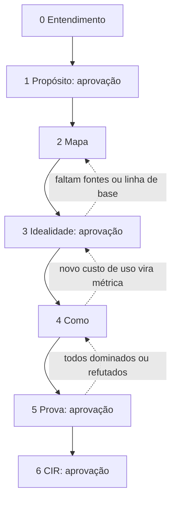

# Fluxo da Etapa 1

**Estado:** desenho do fluxo completo; a [condutora alpha](implementacao-condutora.md) entrega protocolo e mecanismos locais, com demais skills e integrações pendentes. **Revisão:** 2026-10-23. Esta página sintetiza o fluxo; os detalhes de cada sub-etapa permanecem em [S08, seção 3](../sources/originais/fluxograma-completo-ideal.md).

O fluxo transforma uma ideia em **Conceito Ideal de Referência (CIR)**, preservando alternativas e evidências. Seus sete temas organizam os nove passos do [método IDEAL](metodo-ideal.md). A [arquitetura](arquitetura.md) distribui esse trabalho entre skills; os [contratos](contratos.md) descrevem as saídas.

## Temas e aprovações

| Tema | Trabalho e saída | Condição de avanço |
| --- | --- | --- |
| 0. Entendimento | Ficha fiel à ideia, materiais classificados por etapa, preparação do dossiê e modelos por papel | Usuário confirma a ficha |
| 1. Propósito | Propósito único, job, papéis afetados, valores e estado ideal | Aprovação explícita; propósito congelado |
| 2. Mapa | Etapas do job, falhas, causas, contradições, conhecimento, casos candidatos e especialidades | Integração validada; sem trava formal |
| 3. Idealidade | Métricas, linhas de base, limites, Resultado Final Ideal (RFI), refutação e casos congelados | Aprovação explícita |
| 4. Como | Divergência, famílias, esboço, classificação dos elementos e arquiteturas funcionais | Classificação e seleção das famílias passam pelo conselho |
| 5. Prova conceitual | Casos, pré-mortem, red team e comparação; conceito de referência e alternativas vivas | Aprovação explícita |
| 6. CIR | Documento, pacote da Etapa 2, estacionamento da Etapa 3, teste de passagem e relatório de pronto | Aprovação explícita do CIR |

As quatro aprovações dos temas 1, 3, 5 e 6 podem ser chamadas **G1–G4** para facilitar referências; esses identificadores são apelidos editoriais desta documentação. O documento-fonte usa “travas”. Nos temas sem trava, um salto precisa ficar registrado com seu risco; exigências de pronto puladas voltam como pendência no tema 6. A confirmação da ficha continua necessária. [S08, seção 1](../sources/originais/fluxograma-completo-ideal.md).

## Ciclo e dose

Há dois níveis. Cada tema começa com entendimento e planejamento da dose, percorre suas sub-etapas e termina com integração, validação conjunta e decisão. Cada sub-etapa aplica, na dose pertinente:

1. Entender o que o usuário tem em mente, pelo grill.
2. Registrar sua versão antes das ideias da IA; sem versão, propor várias alternativas.
3. Triar falhas fatais nas restrições preservadas.
4. Pesquisar para desenvolver a versão.
5. Fazer perguntas embasadas e contraexemplos.
6. Conferir as respostas contra a evidência.
7. Elaborar em equipe e gerar alternativas isoladas.
8. Validar às cegas, com pesquisa para refutar.
9. Deixar o usuário escolher, combinar ou pedir nova rodada.
10. Registrar decisão, evidência, dissenso, confiança e condições de reversão.

A triagem reformula um alvo impossível em princípio para seu limite máximo possível; dificuldade tecnológica atual vira fronteira da Etapa 2. Preservar a origem de uma ideia não obriga sua inclusão no CIR.

| Dose | Trabalho previsto |
| --- | --- |
| Leve | Pesquisa focal, elaboração individual, conselho rápido e registro mínimo |
| Padrão | 2–3 pesquisadores; equipe de 3 especialistas mais crítico, 2 rodadas; gerador cego e conselho rápido |
| Completa | 3–5 pesquisadores; equipe de 3–5 mais crítico, até 3 rodadas; 2–3 geradores cegos, conselho completo e verificação técnica quando necessária |

A dose aumenta com divergência relevante, possível falha fatal, contradição com evidência ou grande efeito sobre decisões seguintes. Diminui para saídas descritivas já fundamentadas e validadas. A condutora propõe; o usuário ajusta. A dose regula esforço e preserva as aprovações. [S08, seções 2.1–2.4](../sources/originais/fluxograma-completo-ideal.md).

## Alternativas, avaliação e convergência

O tema 4 parte dos desafios derivados do mapa. Prevê aproximadamente 70% do esforço no núcleo e 30% em tangentes, ajustáveis pela surpresa; gera 20–30 ideias por rodada, organiza pelo menos três famílias distintas e produz um esboço de 1–2 páginas. A abstração transforma elementos em funções, métricas de custo de uso, restrições anti-ideais ou itens encaminhados a outras etapas. Seguem 2–3 famílias, retirando somente as claramente dominadas. Cada arquitetura recebe 3–5 cenários, incluindo adversário e evidência insuficiente.

A prova começa antes da geração: o tema 2 reúne 15–30 casos candidatos; o tema 3 congela 10–20 de trabalho e cerca de um terço adicional reservado. Geradores não veem os reservados antes do tema 5. A saída ideal considera apenas informação observável à época. Isso é avaliação conceitual; execução e eficácia do sistema ainda precisam de demonstração.

O conselho compara conceitos com a melhor abordagem atual, critério a critério, usando `+`, `0`, `−` e `?`, sem somar. Elaboração, verificação e julgamento exigem contextos separados; retirar autoria exige também controlar acesso ao contexto. A especificação ainda não entrega esse mecanismo. Consulte [conselho-especialistas](conselho-especialistas.md).

## Retornos, encerramento e retomada

Comparação inconclusiva pede mais casos e ataques antes de gerar novamente. Conceitos todos dominados ou refutados devolvem suas falhas à divergência. Falha numa validação integrada reabre as sub-etapas afetadas. Mudança do propósito exige decisão explícita e revisão dos derivados.

Uma rodada sem família nova encerra a divergência; a regra geral de parada exige ausência de família nova **e** de mudança no CIR. Isso não dispensa pronto nem aprovação. A entrega mantém a referência e 1–2 alternativas vivas. Para retomar entre sessões, o dossiê deve permitir recuperar decisões, pendências e artefatos; o formato operacional está nos [contratos](contratos.md).

## Evolução e pontos em aberto

[S07](../sources/originais/fluxograma-aperfeicoado-cir.md) introduz o ciclo e suas razões; S08 o amplia para 51 sub-etapas, inclui casos reservados e teste de passagem. S07 propunha 3–5 perguntas; S08 deixa quantidade e ritmo ao modelo. S08 recomenda diversidade de famílias de modelos, mas registra v1 com Claude primeiro: essa tensão precisa permanecer visível. O mesmo vale para crítico na elaboração versus avaliador independente, isolamento real e limites operacionais de consumo. Veja [pendências](pendencias.md).
